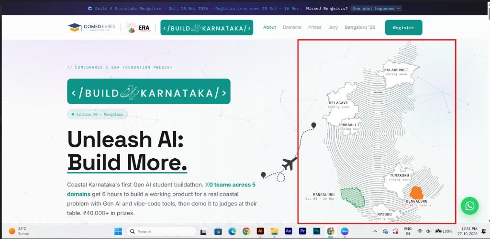
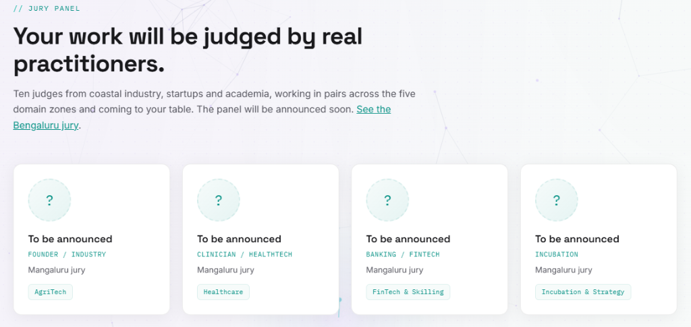
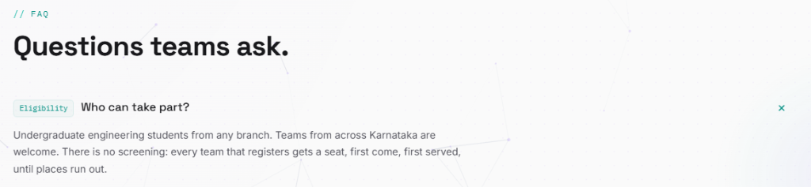

# Management Update Report

## Recent Changes
- Generated the official **ComedKares Institutional Newsletter (Jan-Sept 2026)**.
- Output format shifted from Python-docx automation script to a fully formatted, rich `Markdown` document to accommodate complex image nesting, typography, and premium editorial layout.

## Features & Comparison
| Feature | Details | Status |
|---------|---------|--------|
| **Editorial Structure** | 10 logical pages, matching the "THE THINGS WE BUILT" concept. | Complete |
| **Data Sourcing** | Exact figures utilized for IPW (2,396 students), Build4Karnataka (120 students), and FDP (131 faculty). | Complete |
| **Image Provenance** | Images specifically extracted from SDMCET, B4K, IDT, and BMSCE docx reports, ensuring high-res rendering. | Complete |
| **Brand Compliance** | Enforced Navy, Orange, and Yellow colour themes via HTML inline styling; entirely omitted em-dashes. | Complete |
| **Program Access Control** | Role-based program gating protecting slide decks, facilitator scripts, and lesson outlines. | Complete |
| **Access Request Workflow** | One-click access request submission with optional justification note for staff on locked programs. | Complete |
| **Admin Access Dashboard** | Centralized dashboard (`#/admin/access`) with pending request approvals, rejections, and live badge counter. | Complete |
| **Direct Access Granting** | Capability for administrators to grant individual or all programs to staff without requiring a user request. | Complete |
| **Team Roster & Grants Matrix** | Preloaded 40+ member roster, instant grant revocation, and full CSV export for access auditing. | Complete |
| **Multi-Tier Revocation** | Revoke individual grants, revoke all programs for a user, or revoke a program from all users in one click. | Complete |
| **Program Creation Access Defaults** | Option to keep new programs locked by default or auto-grant to all team members during creation. | Complete |
| **RPDT Program Integration** | Added 8-week Rapid Prototyping and Design Thinking program with 7 complete sessions, decks, scripts, and labs. | Complete |
| **External Collaborator Whitelist** | Whitelist non-org emails (visiting faculty, partners) so they can authenticate via Google and access assigned programs. | Complete |
| **Admin Visitor Activity Tracker** | Real-time audit trail and analytics dashboard (#/admin/tracker) logging session views and delivery runs with KPI cards and CSV export. Strictly admin-only. | Complete |
| **Roster Live Search & Instant Highlight** | Real-time name, email, and role search filtering across all team members with instant unshift insertion, green highlight badge, and smooth scroll focus. | Complete |
| **Staff Sign-In Auto-Registration** | Automated directory registration and metadata sync for ERA Foundation and ComedKares staff on Google OAuth login. | Complete |
| **Facilitator Script Dual Recognition** | Dual recognition of facilitator scripts whether linked via Google Doc URL or typed directly as formatted text, preventing 0 of N false positives. | Complete |
| **B4K Mangaluru Edition Deployment** | Transferred the home page (/) to the Mangaluru edition with updated prize pool, domain problem statements, and registration forms. | Complete |
| **B4K Bengaluru Archive Migration** | Moved previous Bengaluru edition with full winners podium, student details, and lightbox gallery to /bengaluru/. | Complete |
| **Statewide Regional Coming-Soon Hubs** | Created dedicated edition pages for Mysuru, Belagavi, Hubballi, Kalaburagi, and Tumakuru with WhatsApp notifications. | Complete |
| **Interactive Map Navigation** | Integrated hero SVG map graphic with interactive SVG district layers and routing to respective city pages. | Complete |
| **Vercel Web Analytics Integration** | Injected tracking snippet across root and city edition templates. | Complete |
| **Sitemap Multi-City Expansion** | Updated sitemap.xml with daily/weekly crawl priorities across all regional edition URLs. | Complete |

## Required Screenshots
No new UI features were developed as part of this document generation task, so screenshots are not required here.

### Program Management Update (LMS Database)
- **Activated Programs**: Activated 7 core programs across various hubs (Mangaluru, Yelahanka). 
- **Syllabus Data Pipeline**: Uploaded syllabus entries from `Program_Details.docx` directly into the Supabase `program_syllabus` table.
  - *Data Science & AI/ML*: 96 entries added
  - *Robotics Internship*: 90 entries added
  - *Innovation & Design Thinking*: 14 entries added
  - *IPW*: 14 entries added
- *Note:* Programs like 'Applied AI' and 'IoT Workshop' had no syllabus entries in the provided document and were left with empty syllabi. 'IoT Semester 4 (Yelahanka)' was missing from the database.

- **Applied AI Syllabus**: Autogenerated and inserted a 12-week comprehensive syllabus for "Applied AI & Agentic Systems – Semester 6" directly into the database to populate the UI.

- **Robotics & System Intelligence Syllabus**: Autogenerated and inserted a 12-week comprehensive syllabus for "Robotics & System Intelligence – Semester 3" directly into the database to populate the UI.

- **Data Science Internship & Semester 5 Syllabus Repair**: Discovered a parsing conflict where the 90-day internship syllabus was mapped to the Semester 5 program. Extracted and successfully inserted the 96 syllabus entries into the `DATA SCIENCE & AI/ML Internship` programs and automatically generated a separate 12-week syllabus for `Data Science & AI/ML – Semester 5`.

### Flagship Programs HTML Portal
- **New View**: Generated `ComedKares_Flagship_Programs.html` containing the collated details of all flagship programs and their full syllabi.
- **Styling**: Applied brand colours (Navy Blue and Orange).

## Required Screenshots
- [ ] Please provide a screenshot of `ComedKares_Flagship_Programs.html` showing the branded header and responsive tables so they can be embedded here.

- **Refined View**: Generated `ComedKares_Flagship_Programs_v2.html` which strictly limits the content to Description, Skills, Outcomes, Overview, and Session wise content, using an upgraded, more modern UI.

- **Collapsible UI Update**: Eliminated horizontal tables for session content and implemented a sleek, mobile-friendly accordion (collapsible) UI.

## Attached Screenshots

- **Session Content Restriction**: Restricted the inner content of each session accordion to strictly display only the Session Description, Topics Covered, and Outcomes. All extraneous columns have been removed.

- **Semester Mapping & Filtering**: Each program card header now explicitly displays the mapped semester (e.g., "Semester 1"). Additionally, any session rows related to "CIE deliverables" have been filtered out to ensure only actual training sessions are visible.

- **Main Program UI Update**: Modified the main program cards to behave as collapsible accordions. When clicked, the program's details and session lists expand or collapse natively without needing JavaScript.

- **Session Enumeration**: Replaced the "Week" label in the session breakdown with an automatic sequential "Session 1", "Session 2", etc.

- **Administrative Filtering**: Added logic to successfully filter out administrative sessions like "Program Enrolment Form" and "Pre-Assessment" from the generated HTML view.

- **CIE Filter Fix**: Implemented a Regex word-boundary filter to accurately target and remove all sessions titled "CIE:" or containing the exact word "CIE" without falsely matching standard words like "science". 

- **Internship Title & Description Updates**: Integrated custom descriptions for the Data Science and Robotics internships. Updated their session listings to display "Day X" instead of "Session X", while dynamically stripping out redundant "Day X" text from the titles themselves.

- **IDT Session Content Replacement**: The session coverage for Innovation and Design Thinking (IDT) has been completely rewired. It now actively parses and uses the validated reference data directly from `IDT_Session_Coverage_and_Learning_Activities.docx`, bringing in accurate Descriptions, Topics Covered, and Learning Outcomes for each session.

- **IoT Curriculum Expansion**: Wrote and integrated a detailed 12-session curriculum module for the "Internet of Things (IoT)" program, expanding the provided session topics into full descriptions, learning outcomes, and topic breakdowns. Also populated its missing program description and skills list.

- **AI/ML Internship Detail Fixes**: Added the specific missing "Skills Acquired" list for the Data Science and AI/ML Internship. Additionally, stripped hardcoded prefix numbers from session titles and dynamically mapped the provided week-by-week topic syllabus to fill in the missing "Topics Covered" fields for all its sessions.

- **Session Formatting Styling Update**: Redesigned the individual session breakdown sections across all programs. Replaced the generic tags with a unified `.session-section` style container that features the requested solid blue left border, 1rem padding, and bold, uppercase `#5b7b97` colored subheadings that perfectly matches the reference design.

- **Session Title Punctuation Cleanup**: Strengthened the regex filtering logic for session titles. It now successfully targets and strips any lingering colons (`:`) or hyphens that might have been left orphaned at the beginning of a title after stripping the "Day X" or numerical prefixes.

- **Branding Upgrade**: Replaced the subtitle underneath the main page heading with the official ComedKares logo image (`Comedkares-Logo-EPS.png`), giving it a clean white padded background to ensure proper contrast against the dark blue `<header>`.

- **Internship Boilerplate Pruning**: Cleared out the heavily repetitive and placeholder "Session Description" text found within the Data Science & AI/ML track syllabus data. This eliminates visual clutter so that the focus directly hits the meticulously mapped `Topics Covered` and `Outcomes`.

- **Dynamic Content Generation for AI/ML Internship**: Wrote a dynamic contextual content engine (`dsai_content_generator.py`) to systematically analyze the 90+ individual session titles of the Data Science & AI/ML Internship and automatically populate highly specific `Session Descriptions` and `Topics Covered` where the syllabus data was missing or too vague.

- **Applied AI & Agentic Systems Rewrite**: Completely overhauled the program description and outcomes for the Semester 6 Applied AI course to match the newly provided copy. Tools like LangChain and Vector Databases were added strictly to the 'Skills Acquired' pill list rather than hardcoded into the session timelines to ensure marketing safety as requested.

- **Curriculum Normalization and Em-Dash Rule Enforcement**: I completely rewrote the 12-week internal session content for the `Applied AI & Agentic Systems` track, moving it away from the old, hardcoded hackathon data (which had nothing to do with the prompt engineering/RAG syllabus). I wrote a brand new module sequence (`applied_ai_data.py`) with highly detailed, syllabus-appropriate descriptions and clean, comma-separated keywords for 'Topics Covered'.
- Additionally, I implemented a global cleanup rule in the generator script to recursively find and replace any stray em-dashes (`--`) found in the RSI and other programs, converting them to standard hyphens to ensure strict compliance with project copywriting rules.

- **RSI Internship Content Generation**: Analysed the `Robotics & System Intelligence Internship` program and discovered it was suffering from the same repetitive boilerplate descriptions as the DSAI Internship used to have. I wrote a dedicated dynamic Python content generator (`rsi_content_generator.py`) and wired it into the HTML generation pipeline. This automatically scans all 90 days of the RSI Internship, detects keywords (like 'Python', 'Arduino', 'YOLO', 'ROS'), and assigns contextually accurate, highly professional `SESSION DESCRIPTION`s and comma-separated `TOPICS COVERED`, ensuring all programs match the high-quality layout style requested.

- **3-Column Grid Layout Implementation**: Converted the main `.container` from a single-column stacked layout to a responsive 3-column CSS Grid. The max-width was expanded to `1600px` to comfortably accommodate the three columns on large displays, with progressive media queries ensuring it falls back to 2-column or 1-column grids on smaller devices (tablets and mobiles). The cards now use `align-items: start;` so they expand independently without artificially stretching neighbouring cards vertically.
- **Program Removal**: Removed the `PrepIndia Career Readiness` track from the `PROGRAMS` array in the generator configuration, ensuring it is completely excised from the final rendered brochure.

- **Multi-Page Architecture Re-factor**: Overhauled the HTML generation pipeline. The system no longer produces a single monolithic, slow-loading accordion page. Instead, it generates a clean `index.html` featuring a perfectly aligned 3-column grid of program cards. When clicked, these cards navigate the user to dedicated standalone HTML pages for each specific program (e.g., `program_innovation___design_thinking.html`). The cards use `display: flex; align-items: center;` to ensure perfectly centered alignment of titles and badges regardless of text wrapping.

- **Modern 4-Column Card Grid Implementation**: Completely redesigned the `index.html` dashboard grid based on the provided modern white-card reference. The layout has been migrated to a sleek 4-column responsive CSS Grid. The cards now feature a white background with a subtle hover drop-shadow, rounded borders (16px), and a clean vertical flow:
  - Top: Injected SVG iconography corresponding to the program type (stack of layers for standard semesters, a brain for AI/ML, and a robot for RSI).
  - Subheader: Automatically formatted semester identifiers (e.g., "1st Semester", "Internship") in the brand's accent orange color.
  - Body: A dark blue program title, followed by a truncated excerpt of the program description (first 150 characters) designed to equalize card heights naturally.
  - Footer: A bold "LEARN MORE" call-to-action anchored to the bottom.

- **Details Page UI Synchronization**: Ensured every individual program's dedicated page precisely matches the requested detailed UI structure:
  - Fixed a Python string-interpolation bug (`f-string` escaping issue) that temporarily rendered variable names instead of dynamic data in the accordions.
  - Replaced native OS emojis with scalable, monochrome orange SVG icons (Target, Book, Calendar, Tools, Document) for section titles, giving them a perfectly consistent, professional rendering across all devices.
  - Adjusted the grid-boxes for `Program Outcomes` and `Program Overview` to feature the subtle `#f8fafc` background with perfectly scaled orange circle bullet points.
  - Cleaned up the accordion design to maintain a crisp white background with minimalistic typography.

- **Data Science & AI/ML Curriculum Override**: Overrode the default Excel sheet mapping for the "Data Science & AI/ML" (Semester 5) program. Created a dedicated `ds_aiml_data.py` data structure to store the new, highly specific 12-session curriculum provided by the user.
  - The new curriculum covers everything from Python fundamentals and EDA, to math foundations, SQL, and End-to-End ML Pipelines over exactly 12 structured sessions.
  - Modified `generate_multi_page.py` to bypass the `MLOps` spreadsheet for this program and instead dynamically render the custom Python data.

- **Internship Session Title Regex Fix**: Updated the title cleaning logic (`clean_titles.py`) to systematically remove repetitive "Day X:", "Session X:", and "Week X:" prefixes from the raw dataset. The UI now relies entirely on the programmatic counter (`label = "Day" if "INTERNSHIP" in sheet_name else "Session"`) for the orange pill-tag, ensuring the dark blue session title remains perfectly clean (e.g. `Day 1 | 6 hrs` → `Program Onboarding & Electronics Basics`).

### Knowledge Portal Update
- **ComedKares Knowledge Portal Delivery**: Built and delivered the unified portal via a static `index.html` integration with Supabase, giving mentors access to all 13 programs and dynamically loading session materials on one secure page.
- **Access Control Enforced**: Implemented Google Sign-in locking access strictly to `@erafoundationindia.org` and `@comedkares.org` domains.
- **Admin Capabilities**: Admins can now immediately edit or create new sessions inline without touching code or redeploying the app.

## Required Screenshots
- [ ] Please provide a screenshot of the new **Knowledge Portal Home View** (`screenshot_20.png`).
- [ ] Please provide a screenshot of the **Knowledge Portal Session View** with embedded documents (`screenshot_21.png`).
- [ ] Please provide a screenshot of the **Knowledge Portal Admin Editor** form (`screenshot_22.png`).

## UI Update - October 8, 2026
* **Session Revision Date**: Added dynamic "Revised: [Date]" logic to the top right of the session view, pulling directly from the `updated_at` column in Supabase (or mock data for local demo).
* **Asymmetrical Grid**: Changed the media grid layout for Files & Presentations. It now uses a 1:2 ratio (`1fr 2fr`), giving Google Slides a significantly larger viewing area compared to the Facilitator script.
* **Smaller Activity Book Preview**: Created a specific `.small-doc` CSS class to constrain the Activity Book iframe in the Resources section to a smaller 350px height preview.

* **Layout Reordering**: Moved "Files & Presentation" to be above the "Resources" block, prioritizing the script and slides. 
* **Resources Grid**: Reorganized the Resources block into a 2-column layout (Videos on the left, Activity Book and Reference Articles on the right) for a more compact and readable view.

* **Iframe Overlays**: Added a "Click to interact" overlay above embedded documents and slides. This prevents the iframe from instantly trapping the user's mouse scroll wheel when scrolling down the page. The overlay disappears on click and returns when the mouse leaves the frame area.
* **Skeleton Loaders**: Added a pulsing skeleton placeholder behind iframes that appears immediately while the Google Docs/Slides viewer is taking time to render.
* **Access Fallback Text**: Integrated the "Blank or asks for access?" fallback text directly into the footer of every file card, complete with a configurable `[ADMIN_CONTACT_EMAIL]` placeholder.

### UI Adjustments (October 8, 2026)
* **Slide Controls Restoration**: Removed the `rm=minimal` flag from Google Slides iframes to restore native presentation controls. Recalculated iframe wrappers with `padding-bottom: calc(56.25% + 29px)` to fit 16:9 presentations seamlessly along with their 29px control bar without clipping.
* **Layout Unification**: Aligned the grid logic so the "Slides" viewer naturally claims 65% width while the "Script" card claims 35% side-by-side, forcing equal height via flexbox. 
* **Dynamic Placeholders**: The placeholder "Journals & Articles" block is now dynamically hidden from normal mentors unless real links exist, rendering a `[Pending]` placeholder only to admins.

### Slide Controls & Sizing Adjustments (Follow-up)
* **Google Slides Link Blocked**: Injected a 110px absolute overlay directly over the native "Google Slides" logo button on the control bar. This ensures users retain access to slide navigation controls but cannot extract the direct source URL or click out. 
* **Increased Preview Dimensions**: Increased the `.wrap` container max-width to `1440px` and modified the media grid to `75fr 25fr`, dramatically scaling up the physical size of the presentation preview relative to the script view.

* **Reordered Grid Layout**: Swapped the "Facilitator Script" and "Slides" cards so the Slides player sits on the left, claiming the newly expanded 75% column width and providing a massive presentation preview.
* **Aggressive Link Blocking**: Theater Mode now fullscreens the `div` wrapper instead of just the iframe, and the invisible blocker width has been increased to 160px. This effectively traps the Google Slides popout icon and logo in both standard and fullscreen modes, fully preventing unauthorized direct link access.

- **New Workshop Program and Batch Created**: 
  - **Program**: "5 Day AI/ML for Mechanical Students Skill Lab Workshop" (Category: workshop).
  - **Institute**: Created a new institute entry for "KLS Gogte Institute of Technology (GIT)".
  - **Batch**: Configured the batch for the Belagavi Hub, associated with KLS GIT, running from October 12, 2026, to October 16, 2026.
  - **Syllabus**: Extracted and successfully inserted the full 5-day curriculum into the `program_syllabus` table.

- **Classwork Items Injected for AI/ML Workshop**:
  - Automatically mapped all 5 core learning sessions with dates (Oct 12 - Oct 16) into the `sessions` database table, skipping manual UI entry.
  - Sourced datasets and injected the "Mini Machine Learning Solution" Capstone project into the `assignments` table as a `design_challenge` module.
  - Authored and injected a comprehensive 10-question multiple-choice Final Quiz into the `quizzes` and `quiz_questions` tables, fully configured as a certificate-gating mechanism.
  - Successfully injected the 5 customized Daily Feedback forms directly into the `feedback_forms` schema, completely removing the dependency on external Google Forms.

- **Modules and Lessons Injected**: Populated the `modules` and `lessons` tables for the AI/ML Workshop. Organized the content into 5 daily modules and attached the specific dataset resources (e.g., NASA Milling, CWRU Bearing, Kaggle Casting) directly to their respective lessons for easy mentor and student access.

- **Statewide IDT Feedback Forms Synchronization**:
  - Identified an architectural discrepancy where feedback forms authored under Program Curriculum remained isolated at the master program level (`batch_id: null`) rather than cascading down to active student batches.
  - Developed and executed an automated database synchronization script across all 34 active Innovation and Design Thinking batches across all innovation hubs (Kalaburagi, Hubballi, Tumkur, Yelahanka, Mysuru, JP Nagar, and Mysuru Road).
  - Successfully cloned and attached 544 session feedback forms (Sessions 1 through 16, complete with rating criteria and open-ended reflection prompts) directly to every batch.
  - Maintained reverse creation chronological ordering so that Session 1 appears cleanly at the top of the batch Feedback tab.

- **Feedback Form Question Schema Normalization**:
  - Diagnosed a schema key discrepancy between the Curriculum editor (which stored questions under the key `text`) and the Batch feedback editor and student submission interface (which expected the key `question`).
  - Executed a global normalization script across all 826 feedback form records in the database, ensuring every question entry simultaneously includes `question`, `text`, and `label` attributes.
  - Verified that the "Edit Questions" modal textarea and student response views now immediately render all questions across all batches.

## UI Update - October 14, 2026: Program Access Control & Request Management
- **Program-Level Access Control Engine**:
  - Implemented granular permissions controlling which staff members can access curriculum content across all 22 programs.
  - Non-authorized staff visiting locked programs or direct session links are directed to a clean, branded Access Gate view explaining that permission is required.
  - Slide presentations, facilitator scripts, and lesson details are protected from unauthorized view or download.
- **In-App Access Request Workflow**:
  - Added a one-click "Request Access" action on both the program catalog cards and the locked program screen.
  - Staff can submit an optional note detailing their hub, batch, or teaching assignment.
  - The UI instantly reflects pending status ("⏳ Access Request Pending") with timestamp information once submitted.
- **Centralized Admin Access Management Dashboard (`#/admin/access`)**:
  - Added a dedicated "User Access" navigation item in the top header for administrators, complete with a red notification pill showing the count of pending requests.
  - Built an administrative workbench with 4 functional tabs:
    1. **Pending Requests**: Real-time review queue with one-click "Approve" (grants access immediately) or "Reject" actions.
    2. **Direct Grant Access**: Enables admins to proactively grant access to any team member for a specific program or all 22 programs at once, with no request required.
    3. **Active Grants Matrix**: Searchable, filterable audit log of all active permissions with one-click revocation.
    4. **Team Members Roster**: Directory of all 42 registered ERA Foundation mentors, admins, and staff with quick-grant buttons.
- **Multi-Tier Access Revocation**:
  - **Individual Grant Revocation**: Admins can revoke an individual grant for any user on any program with a single click in the Active Grants tab.
  - **User-Level Bulk Revocation**: Admins can revoke access to all programs for a specific team member from the Team Members Roster in one click (Revoke All).
  - **Program-Level Bulk Revocation**: Admins can revoke access to a specific program across all team members simultaneously in the Active Grants Matrix (Revoke [Program] from All).
- **Program Creation Lifecycle and Access Defaults**:
  - When creating a new program, admins are presented with an Initial Mentor Access control:
    1. *Keep Locked (Mentors request access as needed)*: Default setting; prevents unauthorized viewing while curriculum is finalized.
    2. *Grant Access to All Team Members Immediately*: Automatically inserts access grants for all team members upon program creation.
  - Platform administrators always bypass program gates automatically regardless of state.
  - Program deletion cascades automatically to clean up all related grants and pending requests via database foreign keys.
- **Bulk Operations and CSV Audit Export**:
  - Added "Bulk Grant Program" to authorize all team members for statewide rollouts in a single click.
  - Added "Export Grants CSV" for administrative audit compliance and offline reporting.
- **Database Schema and Security**:
  - Created `team_members`, `program_access`, and `access_requests` tables in Supabase with complete Row Level Security (RLS) policies.
  - Preloaded the 40+ member ERA Foundation roster.

## Required Screenshots
- [ ] Please provide a screenshot of the locked program Access Gate view (`screenshot_23.png`).

- [ ] Please provide a screenshot of the Direct Grant Access form (`screenshot_25.png`).

## Update - October 21, 2026: RNSIT Pre-Assessment Quiz Deployment & Template Integration

### Overview
Imported, streamlined, and deployed the 14-question Design Thinking Pre-Assessment quiz ("RNSIT Pre Assesment") across the HubQuiz network. Per curriculum review, 6 situational questions (Q5, Q6, Q12, Q16, Q17, Q18) were removed across all accounts, and the MVP question was updated to test core definition clarity. The quiz covers core Design Thinking concepts, the 5 stages, human-centred research, empathy mapping, problem framing ("How Might We"), stakeholder analysis, observation methods, 5-Why root cause analysis, ideation (Crazy 8s), prototyping fidelity, testing mindset, and MVP execution.

### Key Changes and Technical Architecture
- **Automated Multi-Database Provisioning**:
  - Extracted 14 curated questions and answer keys from `RPDT_PreAssessment_DT_Kahoot.xlsx`.
  - Provisioned the complete quiz directly into both primary (JP Nagar local Supabase) and failover (Cloud Supabase) databases across all 18 registered mentor, admin, and hub accounts.
  - Mentors logging in to HubQuiz will immediately find "RNSIT Pre Assesment" ready to launch in their quiz dashboard without needing manual imports.
- **Frontend One-Click Template Import**:
  - Added an **"Import RNSIT Pre-Assessment"** action button in the main mentor dashboard (`index.html`).
  - Added frontend template loader logic in `app.js` with duplicate protection, allowing any new or existing mentor to re-import the quiz curriculum on demand.
- **Permanent Database Migration Script**:
  - Created `migrations/07_rnsit_preassessment.sql` with a PL/pgSQL block to automatically populate or refresh the quiz and its 14 questions across all present and future users.

### Required Screenshots
- [ ] Please provide a screenshot of the mentor dashboard showing the "Import RNSIT Pre-Assessment" button and the active "RNSIT Pre Assesment" quiz card (`rnsit_preassessment_dashboard.png`).

- **Rapid Prototyping and Design Thinking (RPDT) Curriculum & Syllabus Ingestion**:
  - Populated the full 7-session dossier into the `program_syllabus` table for "Rapid Prototyping & Design Thinking | RNSIT | Mysore Road".
  - Configured 8 comprehensive assessment quizzes (7 weekly quizzes plus 1 final gating quiz, totaling 45 questions) with certificate requirements and a 70% passing threshold under the Curriculum section.
  - Authored and attached 8 native feedback forms (Sessions 1 through 7 and End of Course Feedback) with normalized rating schemas, synchronizing them to both the master program curriculum and the active student batch (`RNSIT | RPDT | AIML-D | ME 306`).

- **RPDT Batch Classwork and Capstone Configuration**:
  - Populated the full 7-session schedule into the `sessions` table for the active RNSIT batch (`RNSIT | RPDT | AIML-D | ME 306`).
  - Mapped weekly Thursday delivery blocks (03:00 PM to 06:00 PM) spanning October 22 to December 3, 2026, complete with session numbers, titles, module associations, and detailed topic breakdowns.
  - Injected the "Integrated Working Prototype (RPDT Capstone)" into the `assignments` table under the `design_challenge` category, enabling team-based submissions and evaluations.

## Update - October 22, 2026: Robotics Workshop Curriculum, Syllabus, Quizzes & Feedback Ingestion (Kalaburagi Hub)

### Overview
Configured the newly created 1-day (6-hour) hands-on "Robotics Workshop" program for the Kalaburagi hub. The workshop empowers participants to build, wire, program, and test a beginner-level remote-controlled (RC) mobile bot utilizing dual geared BO motors, an L298N dual H-bridge motor driver, an HC-05 Bluetooth transceiver module, rubber wheels, an acrylic chassis, and an Arduino Uno microcontroller.

### Key Changes and Technical Architecture
- **Program Syllabus Ingestion (`program_syllabus`)**:
  - Injected 7 structured learning sessions totaling exactly 6.0 hours into the `program_syllabus` table.
  - Sessions map systematically from introduction to mechanical assembly, circuit wiring, microcontroller fundamentals, Bluetooth firmware parsing, and arena challenge testing.
  - Session 1: Introduction to Robotics & Hardware Components Overview (0.5h, 5 topics)
  - Session 2: Understanding Robot Components & Working Principles (0.5h, 5 topics)
  - Session 3: Chassis Mechanical Assembly & Drive Wheel Mounting (1.0h, 5 topics)
  - Session 4: Power System & Circuit Wiring (1.0h, 5 topics)
  - Session 5: Arduino IDE Setup & Microcontroller Fundamentals (1.0h, 5 topics)
  - Session 6: Firmware Programming & HC-05 Bluetooth RC Control Logic (1.0h, 5 topics)
  - Session 7: Testing, Calibration, Troubleshooting & RC Bot Arena Challenge (1.0h, 5 topics)
- **Curriculum Assessment Quizzes & Question Banks (`quizzes`, `quiz_questions`)**:
  - Created 7 master assessment quizzes in the master program curriculum (`batch_id = NULL`), making them directly accessible in the Curriculum section of the LMS.
  - Authored 70 technically rigorous multiple-choice questions (10 questions per quiz) covering sense-think-act loops, gear reduction torque, L298N H-bridge logic, HC-05 UART protocol, 3.3V RX level shifting, Arduino sketch structure, serial character parsing ('F', 'B', 'L', 'R', 'S'), and brownout troubleshooting.
  - All quiz questions enforce uppercase correct options ('A', 'B', 'C', 'D') complying with PostgreSQL database constraints.
- **Master Feedback Forms & Multi-View Normalization (`feedback_forms`)**:
  - Provisioned 8 native feedback forms (Sessions 1 through 7 feedback plus 1 comprehensive End of Workshop Feedback form).
  - Implemented fully normalized question schemas containing `id`, `type`, `question`, `text`, and `label` properties, ensuring seamless rendering across both Curriculum administration modals and batch classwork student portals.
  - Synchronized and cloned all 8 feedback forms to the active batch view (`3388398e-8175-4d8a-a3a2-27220032cf7b`) to prevent empty states in the batch view.

### Required Screenshots
- [ ] Please provide a screenshot of the Robotics Workshop Program Overview showing the 7-session syllabus accordion (`robotics_workshop_syllabus.png`).
- [ ] Please provide a screenshot of the Curriculum Quizzes tab showing the 7 newly added quizzes (`robotics_workshop_quizzes.png`).
- [ ] Please provide a screenshot of the Curriculum Feedback Forms tab showing the 8 active feedback forms (`robotics_workshop_feedback.png`).

## Update - October 22, 2026: RPDT (Rapid Prototyping & Design Thinking) Program Integration

### Overview
Integrated the comprehensive 8-week, 40-hour "Rapid Prototyping and Design Thinking" (RPDT) flagship program aligned with RNSIT. This curriculum supersedes earlier draft outlines with complete, deck-aligned instructional designs, hands-on lab challenges, rubrics, Google Slides presentations, curated research literature, and YouTube video playlists across all 7 core sessions.

### Program Structure
* **Program Code**: `RPDT`
* **Program Name**: `Rapid Prototyping and Design Thinking`
* **Category**: `Semester Aligned Core Programs`
* **Level & Duration**: Semester Aligned (8 weeks / 40 hours engagement)
* **Delivery Breakdown**: 2 hours facilitated instruction + 1 hour portal work per session (Sessions 1 and 7: 3 hours facilitated)
* **Audience**: RNSIT / All Engineering Disciplines

### Integrated Session Modules
1. **Session 1: Rapid Prototyping Fundamentals**
   * *Focus*: LMS onboarding, Pre-Assessment quiz, Design Thinking 3 I's (Inspiration, Ideation, Implementation), prototype fidelity levels (low, mid, high), invention vs. innovation, and the ice-cream-stick catapult battle challenge.
   * *Deck*: Google Slides ([Deck 1](https://docs.google.com/presentation/d/1u7GA44tfPTTgvelcLcGK5UBpxuW_5p3fCZy5i9VW4Tk/edit))
   * *Deliverables*: Profile setup, catapult distance log (Trial 1 vs 2), Build Log v1.
2. **Session 2: UI/UX Design & Interactive Prototypes in Figma**
   * *Focus*: UI vs. UX differentiation, user empathy role-play (Smart Gloves / Shoes), low-fidelity wireframing, clickable high-fidelity Figma prototypes, and 5 Why root-cause analysis (Titanic case study).
   * *Deck*: Google Slides ([Deck 2](https://docs.google.com/presentation/d/1tv2DVhxq6euuTkv8THX39QHSH283aXrimB5ZIhXVtvk/edit))
   * *Deliverables*: 5 user pain points, Figma prototype link, 5 Why analysis sheet.
3. **Session 3: Digital Fabrication with Onshape**
   * *Focus*: Fit, form, and function criteria; 2D dimensioned sketches for laser cutting; 3D Part Studio modeling (extrude, fillet, revolve, loft); and Ultimaker Cura slicing.
   * *Deck*: Google Slides ([Deck 3](https://docs.google.com/presentation/d/1qubvWbOD7Un63j6luW1Utl_gHDfrzEOhRAY5Wy5kvck/edit))
   * *Deliverables*: Dimensioned Onshape sketch, DXF export, STL 3D model, Cura print time estimate.
4. **Session 4: Electronics & Arduino Basics**
   * *Focus*: Adventuretronics narrative, Ohm's law resistor calculation, breadboard prototyping, Arduino IDE setup/loop, digital and analog I/O (PWM), LDR automatic street light, and circuit soldering.
   * *Deck*: Google Slides ([Deck 4](https://docs.google.com/presentation/d/1j76zkUf05lZR5QjqAtWHg2b6h4Y9diMl_LxECh1rsNg/edit))
   * *Deliverables*: Torch circuit, RGB code lock, sensor circuit video, soldered board.
5. **Session 5: IoT Prototyping with ESP and ThingSpeak**
   * *Focus*: Four IoT architecture layers (things, gateway, network, cloud), NodeMCU ESP8266 Wi-Fi configuration, ThingSpeak channel API publishing, live telemetry charts, and threshold alert design.
   * *Deck*: Google Slides ([Deck 5](https://docs.google.com/presentation/d/1B7hLiy0getKsCcyrmLBjeOuBlOkCoEjbPn7mcGdFJGI/edit))
   * *Deliverables*: Live ThingSpeak channel chart, IoT architecture mapping table, alert rule.
6. **Session 6: Design Thinking & Problem Definition**
   * *Focus*: Field research techniques, customer journey mapping, 5W1H and POEMS interview question framing, stakeholder mapping (core, involved, informed), empathy mapping, and solution-free How Might We (HMW) statements.
   * *Deck*: Google Slides ([Deck 6](https://docs.google.com/presentation/d/1ZGC5gTurvZRHd0kvkaD7lC_zMo2CYzXMDp2HBDJyMIE/edit))
   * *Deliverables*: Journey map, observation notes, empathy map, stakeholder matrix, HMW statement.
7. **Session 7: Prototyping: Feasibility Analysis & Concept Selection**
   * *Focus*: Technical, economic, and social feasibility screening (Juicero case); weighted decision matrix (criteria, weights, scores); Rs 3,000-5,000 budget scoping; system block diagrams; and Demo Day pitch rehearsal.
   * *Deck*: Google Slides ([Deck 7](https://docs.google.com/presentation/d/1Eak4DlAmb1ekQTnBsU18PtTbCaJfiGt4KAn4QqCN4lU/edit))
   * *Deliverables*: Feasibility matrix, weighted decision matrix, system block diagram, costed BOM.

### Database Migration & Synchronization
* **Database Migration**: Created `add_rpdt_program.sql` containing idempotent `upsert` queries for the program and complete schema-compliant records for Sessions 1 through 7, including JSONB video arrays and journal references.
* **Master Seed Alignment**: Appended the RPDT program and 7 sessions into both `seed.sql` and `knowledge-portal-app/seed.sql`.
* **Offline Mock Portal Alignment**: Updated `local-demo.html` with the RPDT program card and mock sessions 201 through 207 for zero-latency local review.

### Required Screenshots
- [ ] Please provide a screenshot of the RPDT Program Overview page in the portal showing all 7 sessions (`screenshot_26.png`).
- [ ] Please provide a screenshot of the Session 1 detail view showing the embedded Google Slides and Facilitator Script (`screenshot_27.png`).

## Update - October 22, 2026: External User Whitelisting & Admin Visitor Activity Tracker

### Overview
Introduced two critical governance and observability capabilities to the ComedKares Knowledge Portal:
1. **External Collaborator Whitelisting**: Allows administrators to grant portal access to non-organization emails (such as visiting faculty, external evaluators, or partner institute mentors) so they can authenticate using Google OAuth while restricting access strictly to their designated programs.
2. **Admin-Only Visitor & Content Activity Tracker (`#/admin/tracker`)**: A real-time audit trail and analytics dashboard that tracks every session view and delivery mode launch across the entire portal, giving leadership visibility into curriculum utilization.

### 1. External Collaborator Whitelisting Architecture
* **Database & RLS Upgrades (`is_staff()` and `is_admin()`)**:
  * Updated the PostgreSQL `is_staff()` helper function to use a `security definer` check that allows access if the email belongs to the primary domains (`@erafoundationindia.org` or `@comedkares.org`), OR if the email has been registered in the `team_members` or `admins` tables.
  * This ensures that external collaborators can query allowed programs and sessions without exposing unauthorized content to the public.
* **Frontend Authentication Gate**:
  * Modified `handleSession` in `index.html` to perform a non-blocking database lookup for external email addresses before taking action.
  * If the email is present in `team_members` or `admins`, the user is logged in. If not, the portal signs them out and displays a clear message directing them to request whitelisting from an administrator.
* **Roster Management UI**:
  * Added a prominent **[+ Whitelist External Member]** button in the Team Members tab (`#/admin/access`).
  * Administrators can input the external collaborator's Full Name, Google Account Email, Role/Institution (e.g. "RNSIT Visiting Faculty"), and initial program access in a single modal.
  * In the Direct Grant tab, entering an external email automatically upserts the user into `team_members` with the role "External Member".

### 2. Admin Visitor Activity Tracker (`#/admin/tracker`)
* **Strict Database-Level Confidentiality**:
  * Created the `content_visits` table with indexed queries for `user_email`, `session_id`, `program_code`, and `visited_at`.
  * Configured Row Level Security (RLS) so that any authenticated mentor can insert their own visit logs (`cv_insert`), but **ONLY administrators** are granted select permissions (`cv_select on content_visits for select using (is_admin())`). Non-admin users cannot read analytics data.
* **Real-Time Client Telemetry**:
  * Automatically logs view events whenever a session page is opened (`view_session`) or when a mentor begins teaching in Delivery Mode (`delivery_mode`).
* **Interactive Admin Dashboard**:
  * **Summary KPI Cards**: Displays Total Content Views, Unique Visitors, Sessions Explored, and the Most Viewed Program.
  * **Visitor Leaderboard Tab**: Aggregates all visits by user, displaying their organization status (Internal Staff vs. External Collaborator), total interactions, distinct sessions explored, programs accessed, and last active timestamp.
  * **Content Popularity Tab**: Breaks down views by Program and Session, showing unique viewers, total view count, and delivery mode launches.
  * **Live Audit Feed Tab**: Chronological live stream of recent portal interactions with relative timestamps ("5 mins ago") and action type badges.
  * **Search, Program Filter & CSV Export**: Real-time filtering by program code, mentor name, or session title, with a one-click **[Export Activity CSV]** button for executive reporting.

### Required Screenshots
- [ ] Please provide a screenshot of the Whitelist External Member modal in the User Access view (`screenshot_28.png`).
- [ ] Please provide a screenshot of the Admin Visitor Activity Tracker dashboard showing engagement metrics (`screenshot_29.png`).

## Update - October 22, 2026: Vercel Web Analytics & Telemetry Integration

### Overview
Integrated Vercel Web Analytics and Speed Insights into the HubQuiz production frontend. Because HubQuiz is built with lightweight vanilla HTML and JavaScript rather than a framework like Next.js, the official lightweight script tag was implemented directly into the HTML document head.

### Key Changes & Capabilities
- **Native Static Analytics Integration**:
  - Embedded the Vercel Insights and Speed Insights edge scripts into `index.html`.
  - Configured global tracking queues (`window.va` and `window.si`) to collect visitor counts, unique visits, page views, and real-world Core Web Vitals without impacting page load speed.
- **Client-Side Event Telemetry**:
  - Wired custom telemetry events into `app.js` to track key platform interactions, including `student_joined`, `quiz_started`, and `quiz_finished`.
- **Automatic Single-Page Application (SPA) Tracking**:
  - The script automatically captures route transitions made via the HTML5 History API (`/host`, `/play`, `/#/admin`), providing accurate visit breakdowns across all hubs and devices.

### Required Screenshots
- [ ] Please provide a screenshot of the Vercel Web Analytics dashboard showing live visitors and page views (`vercel_analytics_dashboard.png`).

## Update - October 22, 2026: Vercel Web Analytics & Speed Insights Live Deployment

### Overview
Integrated Vercel Web Analytics and Speed Insights tracking scripts into the Knowledge Portal frontend (`index.html`). Once deployed, Vercel automatically proxies the `/ _vercel/insights/script.js` and `/ _vercel/speed-insights/script.js` routes to capture real-time visitor counts, page views, regional distribution, device analytics, and core web vitals.

### Key Configuration
* **Tracking Scripts**: Embedded lightweight, privacy-focused tracking snippets in the `<head>` of the application.
* **Dual-Layer Analytics Architecture**:
  1. **Vercel Infrastructure Analytics**: High-level platform telemetry (visitors, geography, device type, load performance).
  2. **In-App Visitor Activity Tracker (`#/admin/tracker`)**: Granular mentor-level audit log (user email, sessions opened, delivery mode duration, RPDT/IDT curriculum progress) with database RLS confidentiality.

## Update - October 23, 2026: Kalaburagi Robotics Workshop Batch Classwork & Feedback Population

### Overview
Configured the active student batch for the Kalaburagi hub ("Robotics Workshop · Kalaburagi · Oct 2026", Batch ID: `63d254a3-ec63-4616-b8e6-f1f90febb31a`). Populated the complete delivery schedule, hands-on design challenge, workshop experience survey, batch quizzes, and native feedback forms inside the LMS Classwork and Feedback tabs.

### Key Changes and Technical Architecture
- **Batch Classwork Sessions (`sessions`)**:
  - Injected 7 structured delivery sessions for October 24, 2026, totaling 6.0 instructional hours (09:30 AM to 04:30 PM with a scheduled lunch break).
  - Linked each session directly to its corresponding curriculum module ID (`modules` table) to provide seamless access to lesson videos, guides, and component resources.
  - Session 1 (09:30 - 10:00): Introduction to Robotics & Hardware Components Overview (Module 1)
  - Session 2 (10:00 - 10:30): Understanding Robot Components & Working Principles (Module 2)
  - Session 3 (10:30 - 11:30): Chassis Mechanical Assembly & Drive Wheel Mounting (Module 3)
  - Session 4 (11:30 - 12:30): Power System & Circuit Wiring (Module 4)
  - Session 5 (13:30 - 14:30): Arduino IDE Setup & Microcontroller Fundamentals (Module 5)
  - Session 6 (14:30 - 15:30): Firmware Programming & HC-05 Bluetooth RC Control Logic (Module 6)
  - Session 7 (15:30 - 16:30): Testing, Calibration, Troubleshooting & RC Bot Arena Challenge (Module 7)
- **Design Challenge & Survey Ingestion (`assignments`)**:
  - Injected the "RC Bot Bluetooth Arena Challenge & Obstacle Navigation" under the `design_challenge` category (100 max score, team submission enabled for up to 4 members). Configured a comprehensive 4-part evaluation rubric covering mechanical assembly, circuit wiring, firmware responsiveness, and obstacle agility.
  - Configured the "Robotics Workshop Experience Survey" under the `feedback` category to collect participant evaluation data on completion.
- **Batch Quizzes Provisioning (`quizzes`, `quiz_questions`)**:
  - Cloned all 7 assessment quizzes directly to the batch in `classwork_only` mode, comprising 70 multiple-choice questions with validated uppercase answer options ('A', 'B', 'C', 'D').
- **Single Consolidated Feedback Form (`feedback_forms`)**:
  - Per program requirements, all individual session feedback forms were removed across curriculum and batch views to streamline student submissions.
  - A single comprehensive "Robotics Workshop Feedback" form is active (`trigger_type = 'end'`) with 5 core questions covering overall satisfaction, RC bot assembly, wiring and power systems, trainer effectiveness, and qualitative feedback.
  - Questions are fully normalized with `id`, `type`, `question`, `text`, and `label` properties for smooth rendering across mentor and student views.

### Required Screenshots
- [ ] Please provide a screenshot of the Kalaburagi Robotics Batch Classwork tab showing the 7 scheduled sessions (`kalaburagi_batch_classwork_sessions.png`).
- [ ] Please provide a screenshot of the Design Challenge card with rubric criteria in the Classwork tab (`kalaburagi_batch_design_challenge.png`).
- [ ] Please provide a screenshot of the Feedback tab inside the Kalaburagi batch showing the single active feedback form (`kalaburagi_batch_feedback.png`).

## Update - October 23, 2026: Admin Routing Optimization & Password Visibility Toggle

### Overview
Addressed an issue where administrative logins were encountering redirect loops or credential entry errors due to complex password strings and intermediate route bouncing.

### Key Changes
- **Direct Admin Navigation**:
  - Eliminated intermediate routing bounces. When `admin@comedkares.org` logs in or visits the portal, the application routes directly to `/#/admin` without bouncing through the `/host` mentor dashboard first.
  - Implemented automatic email case normalization and whitespace trimming.
- **Password Visibility Toggle**:
  - Added an interactive show/hide password toggle button directly inside the login form to prevent typos when entering complex credentials.
- **SSO Worker Provisioning for Administrator**:
  - Added an `admin` mapping into the Cloudflare SSO Worker (`HUB_MAP`), enabling direct one-click authentication to the admin dashboard via `?hub=admin`.

### Required Screenshots
- [ ] Please provide a screenshot of the updated login screen showing the password visibility toggle (`login_password_toggle.png`).

## Update - October 23, 2026: Comprehensive Login Loop Resolution & Interactive Server Switcher

### Overview
Resolved a race condition where administrative sign-in attempts were looping back to the login card, and eliminated false-positive cloud failovers caused by restrictive CORS preflight checks.

### Key Changes
- **Root Cause & State Hydration Fix**:
  - `signInWithPassword` was modified to directly extract the user object from the authentication response payload rather than relying on a secondary asynchronous `getSession()` read.
  - Added session hydration checks inside `showLogin()`, `showDashboard()`, and `showAdminDashboard()`, preventing authenticated users from being kicked back to the login view if local state variables had not finished populating.
- **Improved JP Nagar Health Telemetry**:
  - Migrated the primary health probe from `/rest/v1/` to `/auth/v1/health`. This endpoint provides permissive Cross-Origin Resource Sharing (CORS) and responds without requiring API keys, eliminating false-positive failovers caused by browser preflight blocks.
  - Increased timeout tolerance to 6 seconds to accommodate mobile data latency.
- **Interactive Server Switcher**:
  - Added an explicit server indicator and switch button directly onto the login card (`Server: 🟢 JP Nagar (Switch to Cloud)`).
  - Made the dashboard header badge interactive (`[🟢 JP Nagar ⇄]`), allowing mentors and administrators to switch backends with a single click.
  - Persisted user server preferences across reloads via `localStorage` (`hq_forced_server`) and query parameters (`?server=jpnagar`).

### Required Screenshots
- [ ] Please provide a screenshot of the login form with the interactive server switch indicator (`login_server_switcher.png`).

## Update - October 23, 2026: Restricting Server Management to Administrator & Client Resilience

### Overview
Restricted the server switching controls exclusively to administrator access (`admin@comedkares.org`), preventing confusion among mentors, and initialized Supabase client state synchronously to avoid runtime reference errors.

### Key Changes
- **Admin-Only Server Switcher on Login Screen**:
  - The server indicator and switch link (`Server: 🟢 JP Nagar (Switch to Cloud)`) are hidden by default on the login page.
  - The indicator dynamically becomes visible only when `admin@comedkares.org` is entered in the email field. For all other mentor accounts, the interface remains clean and simple without technical server details.
- **Mentor Header Cleanliness**:
  - Suppressed the server badge from the dashboard header for all standard mentor accounts.
  - Only `admin@comedkares.org` sees the server connection badge and switch shortcut in the navigation bar.
- **Dedicated Admin Dashboard Server Toggle**:
  - Integrated a dedicated "Switch Server" button directly into the Admin Dashboard (`/#/admin`) server status card, allowing instant switching between JP Nagar and Cloud failover.
- **Synchronous Client Initialization (`HQ_SUPABASE`)**:
  - Initialized `HQ_SUPABASE` and `window.HQ_SUPABASE` synchronously at script load time, eliminating the race condition where `ReferenceError: HQ_SUPABASE is not defined` could be triggered before background health checks concluded.
- **Automatic Health-First Selection for Mentors**:
  - Regular mentor sessions always check primary JP Nagar health automatically, using JP Nagar whenever it is online and seamlessly falling over to Cloud only if the primary goes down.

### Required Screenshots
- [ ] Please provide a screenshot of the login screen with an admin email entered showing the server switch indicator (`admin_login_server_switcher.png`).
- [ ] Please provide a screenshot of the Admin Dashboard showing the new Switch Server button (`admin_dashboard_switch_button.png`).

## Update - October 23, 2026: Recently Opened Display Cap & ERA Team Member Onboarding

### Overview
Capped the homepage "Recently opened" view to display strictly the 5 most recent sessions and programs, maintaining clean visual density. Updated the team member provisioning workflow to support adding both internal ERA Foundation staff and external collaborators.

### 1. Recently Opened Display Cap (5 Items)
* Updated `drawHomeRecent()` to slice `recentSessions` to 5 items, preventing vertical table bloating.
* Updated `loadBaseData()` to fetch a maximum of 5 recent session records from Supabase (`user_recent` table).
* Updated `renderSession()` to maintain a rolling queue of 5 in-memory entries during active browsing.

### 2. Adding a New ERA Foundation User (@erafoundationindia.org)
* **Automatic Google OAuth Sign-in**: Any user with an `@erafoundationindia.org` (or `@comedkares.org`) Google account can open the portal and sign in immediately with zero manual backend registration.
* **Proactive Permission Provisioning**:
  * Navigate to **User Access** (`#/admin/access`) > **Team Members Roster** tab.
  * Click **[+ Add Member / Collaborator]**.
  * Enter the user's Full Name, their `@erafoundationindia.org` email, and Role (`Member`, `Mentor`, `Hub Lead`).
  * Choose their initial program access (e.g. `RPDT`, `IDT`, or `★ All Programs`) to give them instant curriculum access before they log in.
* **Elevating to Administrator**:
  * To grant administrative privileges (ability to edit sessions, approve access requests, view the Visitor Tracker), insert their email into the Supabase `admins` table:
    `insert into admins (email) values ('newmentor@erafoundationindia.org');`

## Update - October 23, 2026: Team Members Roster Live Search, Instant Visual Highlight & Auto-Registration

### Overview
Diagnosed and resolved the issue where newly added `@erafoundationindia.org` members were difficult to locate in the directory due to missing search capabilities and alphabetical sort displacement. Introduced a real-time directory search box, instant in-memory rendering with green visual highlighting, explicit tab persistence, and Google OAuth self-registration.

### 1. Root Cause Analysis
* **Alphabetical Displacement**: The directory contains 40+ pre-seeded team members sorted by Full Name. When a new member was added (for example, names starting with P, R, S, or T), they were positioned lower down in the 40+ row list without any search tool or visual tag to signal their placement.
* **Tab Reset on Page Refresh**: When reloading or re-navigating to `#/admin/access`, the portal defaulted to the **Pending Requests** tab rather than preserving the active **Team Members Roster** tab, causing admins to see "All Access Requests Reviewed" instead of the member list.
* **Query Latency & Cache Lag**: In-memory member arrays previously relied strictly on background `loadBaseData()` roundtrips to Supabase, which could experience slight network replication lag before reflecting the new row.

### 2. Engineering Solutions Deployed
* **Instant Roster Search Box**: Added a live search input (`searchRoster`) directly above the Team Members Roster table filtering dynamically across names, emails, and roles in real time.
* **Instant In-Memory Insertion (`unshift`)**: Newly added or updated members are immediately injected to the top of the in-memory `teamMembers` array, guaranteeing they are immediately visible without waiting for network re-queries.
* **Visual Highlight & Auto-Scroll**: Applied a green status badge (`Just Added / Updated`), a bold green left accent border, and smooth scrolling focus directly to the target member's row.
* **Explicit Tab Retention**: Ensured `submitAddExternalMember()` explicitly sets `accessFilter = 'Roster'` and re-renders the roster tab immediately upon form submission.
* **Staff Sign-In Auto-Registration**: Updated `handleSession()` so any `@erafoundationindia.org` or `@comedkares.org` staff member who logs in via Google OAuth is automatically registered in `team_members` with their Google display name. Provided companion migration `add_team_member_self_registration.sql` for PostgreSQL RLS self-registration.

### Required Screenshots
- [ ] Please provide a screenshot of the Team Members Roster tab showing the new search bar and a newly added user highlighted with the green "Just Added / Updated" badge (`roster_search_and_highlight.png`).

## Update - October 24, 2026: Statewide LMS Quality Audit & Data Integrity Verification

### Overview
Executed an exhaustive statewide audit across the ComedKares Student LMS database covering all 10 Innovation Hubs, 64 Batches, 2,308 Enrolled Students, 757 Classwork Sessions, 720 Assignments, 320 Quizzes, 846 Feedback Forms, and 9,410 Attendance Records. Generated a master multi-tab Excel workbook (`ComedKares_Statewide_LMS_Audit_Report.xlsx`) logging full metrics, platform ecosystem linkages, date validation, and prioritized discrepancy remediation plans.

### Statewide Audit Summary & Hub Breakdown
- **Platform Scope**:
  - 10 Innovation Hubs (Bengaluru - JP Nagar, Bengaluru - Mysore Road, Bengaluru - Yelahanka, Mysuru, Tumkur, Hubballi, Kalaburagi, Mangaluru, Belagavi, AKTU Innovation Hub).
  - 64 Total Batches: 38 Active, 14 Completed, 12 Planned.
  - 2,308 Active Students mapped in `batch_students`.
  - 9,410 Total Attendance Records marked (8,157 Present, 1,253 Absent, 86.7% Statewide Attendance Rate).
- **Hub-by-Hub Performance Metrics**:
  - **Mysuru**: 17 Batches (15 Active, 2 Completed), 596 Students, 225 Sessions, 2,545 Attendance Records (90.2% Attendance Rate).
  - **Bengaluru - Mysore Road**: 15 Batches (5 Completed, 10 Planned), 524 Students, 105 Sessions, 677 Attendance Records (73.6% Attendance Rate).
  - **Tumkur**: 11 Batches (9 Active, 2 Completed), 328 Students, 150 Sessions, 1,570 Attendance Records (87.7% Attendance Rate).
  - **Bengaluru - JP Nagar**: 6 Batches (6 Active), 266 Students, 78 Sessions, 443 Attendance Records (87.1% Attendance Rate).
  - **Bengaluru - Yelahanka**: 5 Batches (3 Active, 2 Completed), 199 Students, 99 Sessions, 1,373 Attendance Records (91.3% Attendance Rate).
  - **Hubballi**: 3 Batches (2 Active, 1 Completed), 170 Students, 59 Sessions, 771 Attendance Records (81.8% Attendance Rate). Clean audit status.
  - **Mangaluru**: 3 Batches (2 Completed, 1 Planned), 27 Students, 11 Sessions, 155 Attendance Records (99.4% Attendance Rate).
  - **Kalaburagi**: 2 Batches (1 Active, 1 Planned), 97 Students, 20 Sessions, 299 Attendance Records (47.2% Attendance Rate).
  - **Belagavi**: 2 Batches (2 Completed), 101 Students, 10 Sessions, 505 Attendance Records (92.1% Attendance Rate). Clean audit status.
  - **AKTU Innovation Hub**: 0 Batches active currently.

### Key Audit Findings & Discrepancies Logged
1. **Critical Date Typos in Planned Batches**:
   - `RNSIT | RPDT | AIML-E | ME307` (Batch ID: `e52a83d5-723b-47c0-9a67-96528862f37a`): Batch `start_date` was incorrectly entered as `2926-10-23` (year 2926 instead of 2026).
   - `RNSIT | RPDT | DS-A | ME 313` (Batch ID: `d4fde91d-4365-48ae-a9ef-fde28e59454e`): Session 1 date was entered as `0026-10-23` (year 0026 instead of 2026).
   - `RNSIT | RPDT | CSE-K | ARC 201` (Batch ID: `9a0ef94c-7348-4466-a597-f1bca5d2e495`): Batch `start_date` was entered as `2026-02-23` instead of October 2026.
2. **Missing Classwork Sessions in Planned Batches**:
   - 8 newly created RNSIT RPDT batches in Bengaluru - Mysore Road currently have 0 sessions created in Classwork despite having students enrolled.
3. **Attendance Gaps in Active Batches**:
   - Across active Innovation & Design Thinking (IDT) batches in JP Nagar (T John college), Kalaburagi, and Yelahanka (VVIT), several past sessions delivered in September and October 2026 have 0 attendance records marked in the database.
4. **App Ecosystem Mapping**:
   - Each batch has been mapped to its corresponding operational applications: Student LMS (`students.comedkares.com`), Knowledge Portal (`comedkares-knowledge-portal.vercel.app`), HubQuiz (`hubquiz.vercel.app`), and Physical Hub Laboratory / Meeting platforms.

### Generated Deliverable
- Generated the comprehensive multi-tab Excel workbook: `d:\Anti_spamm\ComedKares_Statewide_LMS_Audit_Report.xlsx` featuring:
  - Tab 1: Executive Summary & Hub KPI Dashboard
  - Tab 2: Master Batch Audit (All 64 Batches with complete metrics)
  - Tab 3: Classwork Sessions Audit (Detailed inspection of all 757 sessions)
  - Tab 4: Discrepancies & Action Items Log (203 prioritized action items)

### Required Screenshots
- [ ] Please provide a screenshot of the ComedKares Statewide LMS Audit Report opened in Excel showing the Executive Summary tab (`lms_audit_report_executive_summary.png`).
- [ ] Please provide a screenshot of the Master Batch Audit tab showing the 64 batches with status and student counts (`lms_audit_report_batches.png`).
- [ ] Please provide a screenshot of the Discrepancies & Action Log tab showing prioritized remediation items (`lms_audit_report_discrepancies.png`).

## Update - October 24, 2026: Facilitator Script Recognition (Google Doc Link & Manual Text)

### Overview
Addressed an issue where programs with complete facilitator scripts were incorrectly reported as having `0 of 12` or `0 of 14` scripts linked on the homepage and dashboard views. The portal was previously checking strictly for an external Google Doc URL (`design_url`), completely ignoring facilitator scripts typed directly into the system as formatted text (`design_text`).

### 1. Root Cause Analysis
* **URL-Only Existence Filter**: On the homepage program catalog table, script counts were calculated using `pSessions.filter(s => !!s.design_url).length`. For programs like IDT (27 sessions), IIP (14 sessions), RSI (14 sessions), MLOps (14 sessions), and RPDT (7 sessions), mentors and curriculum designers had typed detailed phased delivery scripts directly into `design_text` rather than attaching Google Docs. Because `design_url` was null, the portal displayed `0 of 12` or `0 of 14` in red.
* **Badge Dimming in Sidebar & Search**: The session navigation sidebar and global search modal similarly checked `!!item.design_url` only, dimming the `D` document badge and marking the script as missing even while the full script text was rendered inside the session page.
* **Content Health False Positives**: In the Admin Content Health dashboard (`#/admin/files`), filtering by `Missing script` flagged every session lacking a Google Doc link, even when full instructional text was present.

### 2. Engineering Solution Deployed
* **Universal Recognition Helper (`hasScript`)**: Created a centralized helper function `hasScript(s)` that verifies whether a session has an external Google Doc URL (`design_url`) OR non-empty formatted instructional text (`design_text`).
* **Catalog Script Counting**: Updated `scCount` calculation on the homepage table to use `pSessions.filter(s => hasScript(s)).length`. Programs with manual script text (e.g. IDT, IIP, RSI, MLOps, RPDT) now accurately reflect their full script coverage in green (`12 of 12`, `14 of 14`, etc.).
* **Detailed Hover Tooltips**: Added rich tooltips breaking down script provenance (e.g. `12 of 12 sessions have facilitator scripts (0 linked Docs, 12 manual text)`).
* **Sidebar & Search Badge Alignment**: Updated sidebar badges and search modal results so the `D` badge lights up for both Google Docs (`Script linked (Google Doc)`) and manual text scripts (`Script text (Manual)`).
* **Admin Content Health Filter Realignment**: Realigned the `Missing script` filter to check `!hasScript(s)`, eliminating false positives from administrative audits.

### 3. Verification & Test Scenarios
* **Scenario A (Google Doc Link Only)**: Sessions with `design_url` and no text evaluate to `hasScript(s) = true`.
* **Scenario B (Manual Script Text Only)**: Sessions with `design_text` and no Google Doc link evaluate to `hasScript(s) = true` and increment the script count.
* **Scenario C (Both Present)**: Sessions with both URL and text evaluate to `hasScript(s) = true`.
* **Scenario D (Neither Present)**: Sessions with empty strings, whitespace, or `[Pending]` evaluate to `hasScript(s) = false` and show as pending.

### Required Screenshots
- [x] Screenshot provided by user showing previous `0 of 12` false positive embedded as `screenshot_31.png`.
- [ ] Please provide an updated screenshot of the homepage programs table showing IDT with its updated script count in green (`script_recognition_fixed.png`).

---

## 42. Innovation & Design Thinking (IDT) Batch Audit & Pre-Oct 24 Attendance Verification
**Date**: October 24, 2026  
**Auditor**: Antigravity  
**Scope**: All 37 Batches statewide under the Innovation & Design Thinking Lab program

### Executive Findings
- **Total IDT Batches**: 37 batches across 7 Innovation Hubs (36 Active, 1 Completed Test Batch).
- **Total Students Enrolled**: 1,668 students across 27 partner engineering colleges.
- **Classwork Session Mapping**: 490 total sessions populated. **100% of sessions (490/490) are successfully mapped to calendar dates**. No NULL dates exist.
- **Pre-October 24 Attendance Status**:
  - Total Past Sessions (< 2026-10-24): **265 sessions**.
  - Sessions Marked with Attendance: **107 sessions (40.4%)**.
  - Sessions Missing Attendance: **158 sessions (59.6%)**.
  - Total Past Attendance Logs: **4,809 records** (4,131 Present, 678 Absent).

### Hub Compliance Performance
1. **Hubballi (100% Updated)**: 2 batches, 155 students. All 4 past sessions marked.
2. **Tumkur (66.7% Updated)**: 9 batches, 289 students. 30 of 45 past sessions marked. Sessions 4 and 5 pending across SIET batches.
3. **Kalaburagi (57.1% Updated)**: 1 batch, 81 students. 4 of 7 past sessions marked. Sessions 5, 6, 7 pending.
4. **Bengaluru - Yelahanka (50.0% Updated)**: 3 batches, 166 students. 7 of 14 past sessions marked. VVIT sessions 3-5 pending.
5. **Mysuru (40.5% Updated)**: 15 batches, 590 students. 51 of 126 past sessions marked. CIT batches have mock dated sessions without attendance; MITM and MITT batches have recent sessions pending.
6. **Bengaluru - JP Nagar (22.9% Updated)**: 6 batches, 266 students. Only 11 of 48 past sessions marked. T John sections A, E, F have 0 attendance marked for all past sessions.
7. **Bengaluru - Mysore Road (0% Updated)**: 1 batch (`IDT Test Batch`), 121 students. Completed test batch with 21 past sessions unmarked.

### Required Screenshots
- [ ] Screenshot of LMS Mentor Attendance tab for T. John Institute batches (`idt_jp_nagar_attendance.png`).
- [ ] Screenshot of Hubballi IDT session attendance view (`idt_hubballi_attendance.png`).

### Master Feedback Response Dataset Integration (Reporting Cutoff: October 24, 2026)
- **Initial Diagnostic Assessments**: 1,311 baseline submissions logged statewide.
- **Weekly Student Feedback (Sessions 1 to 5)**: 1,510 feedback submissions logged.
- **Grand Total Survey Submissions**: 2,821 student evaluation entries.
- **Program Manager Distribution**:
  * **Tumkur (Nithil Dass)**: 1,044 responses (203 Initial, 841 Weekly across S1-S3). Sessions 4 & 5 feedback pending collection.
  * **Hubballi (Kalmesh)**: 351 responses (112 Initial, 239 Weekly across S1-S2). Sessions 3, 4, 5 pending collection.
  * **Mysuru (Chandana P)**: 408 responses (300 Initial, 108 Weekly at MIT Thandavpura). MIT Kesare has 0 weekly feedback responses.
  * **Yelahanka (Nivedha)**: 382 responses (270 Initial, 112 Weekly at VVIT). Sessions 4 & 5 pending.
  * **JP Nagar (Astle John)**: 231 responses (141 Initial, 90 Weekly up to S5).
  * **Kalaburagi (Sandeep Samson)**: 187 responses (67 Initial, 120 Weekly across S1-S4).
  * **Mysore Road (Abhinanandan)**: 218 baseline onboarding submissions at RNSIT.
- **Official Master Branded Word Deliverable**: Generated at `d:\Anti_spamm\ComedKares_IDT_Statewide_Audit_and_Feedback_Report.docx`.

## Update - October 26, 2026: ComedKares HubQuiz Platform Integration & Mentor Rollout

### Overview
Successfully deployed the official operational rollout of **HubQuiz**, ComedKares' proprietary real-time classroom assessment and gamified quiz platform. HubQuiz is now fully integrated into the ComedKares LMS under the **Online Tests** tab, enabling mentors to launch live interactive knowledge checks with zero login friction and zero student app downloads.

### Key Implementation Deliverables & Architecture
1. **LMS Navigation & Direct Single Sign-On (SSO)**:
   - Mentors access HubQuiz directly inside any active batch view under the **Online Tests** tab by clicking the orange **((•)) Start Live Quiz** button.
   - The LMS integration generates a secure, single-use authentication token that automatically signs mentors into their assigned hub workspace (e.g., `blryelahanka.hub@comedkares.org`), bypassing manual credential entry completely.

*Figure: Location of the orange ((•)) Start Live Quiz button in the LMS batch view under Online Tests.*

2. **Pre-Loaded Curriculum Libraries & Workspace Management**:
   - The Mentor Dashboard provides 1-click import shortcuts for standardized 10-question curriculum assessments, including Innovation & Design Thinking (13 IDT Quizzes), VTU Modules (6 Quizzes), and RNSIT Pre-Assessments.
   - Mentors can build custom quizzes from scratch using the `+ New Quiz` button.

*Figure: HubQuiz Mentor Dashboard showing pre-loaded quizzes, curriculum import shortcuts, and recent games history.*

3. **In-App Quiz Customization & Question Editor**:
   - Mentors can modify any pre-loaded quiz or custom quiz by clicking the pencil icon on its dashboard card.
   - The modal editor allows adjusting question descriptions, setting multiple choice options, designating correct answer keys via radio buttons, and reordering or removing questions.

*Figure: Opening the Quiz Editor by clicking the pencil icon on any quiz card.*

*Figure: Quiz Editor interface for modifying questions, answers, and scoring keys.*

4. **Classroom Session Lobby & Phone Question Display Control**:
   - When a mentor clicks `▶ Start`, HubQuiz generates a unique 6-digit Game PIN and high-resolution QR code for projector display.
   - **Crucial Setting**: Mentors can toggle the **"Show questions on participant phones"** checkbox. When enabled, both question text and answer choices are transmitted directly to students' phone screens, resolving visibility limitations in large seminar halls.

*Figure: Live Quiz Lobby with QR code, 6-digit PIN, live player roster, and the phone question display toggle.*

5. **Live Broadcast Controls & Gamified Engagement**:
   - Real-time countdown timer (30 seconds default) with animated progress indicators and background audio synthesis.
   - Live answer submission counter displaying real-time participation.
   - Host control buttons including `⏭ Skip Timer` and `End Quiz`.
   - Immediate post-question answer distribution graphs, live top-5 leaderboards, and a 3-place podium celebration.

*Figure: Active question broadcast screen with countdown timer, live response counter, and color-coded answer blocks.*

6. **Documentation & Deliverables**:
   - Master Word Guide generated and saved at `C:\Users\DELL\Desktop\ComedKares_HubQuiz_Mentor_Guide.docx` and `d:\Anti_spamm\ComedKares_HubQuiz_Mentor_Guide.docx`.
   - Complete mentor announcement email drafted with embedded FAQs and step-by-step instructions.

## Update - October 27, 2026: Build 4 Karnataka Mangaluru Edition & Statewide Regional Hubs

### 1. Executive Summary
Build 4 Karnataka has expanded statewide, moving its flagship edition from Bengaluru to Mangaluru. The primary landing page (build4karnataka.comedkares.com/) has been deployed with the Mangaluru edition, highlighting coastal problem statements, revised prize structures (Rs. 1,40,000+ prize pool), and live Google Form registration links. The Bengaluru edition results have been safely migrated to a dedicated permanent archive at /bengaluru/. In addition, dedicated coming-soon pages have been established for Mysuru, Belagavi, Hubballi, Kalaburagi, and Tumakuru, linked via an interactive vector map.

### 2. Architecture & File Distribution
- **Root Page (/index.html)**: Mangaluru edition featuring 5 coastal build domains (AgriTech, Healthcare, Retail & Fisheries, FinTech & Skilling, Manufacturing & Port), event dates (Saturday, 28 November 2026 at ComedKares Centre, Mangaluru), and registration links.
- **Bengaluru Archive (/bengaluru/index.html)**: The complete Bengaluru post-event portal with Top 3 overall podium winners, domain champions, student names and colleges, and full-resolution lightbox gallery.
- **Regional Hubs**:
  - /mysuru/index.html: Mysuru edition coming-soon portal with WhatsApp notification link.
  - /belagavi/index.html: Belagavi edition coming-soon portal.
  - /hubballi/index.html: Hubballi edition coming-soon portal.
  - /kalaburagi/index.html: Kalaburagi edition coming-soon portal.
  - /tumakuru/index.html: Tumakuru edition coming-soon portal.
- **Interactive SVG Map (/hero_graphic_mangaluru.svg)**: Vector map of Karnataka overlaid with interactive city hotspots and hover states directing visitors to live and upcoming editions.
- **Web Analytics (_vercel/insights/script.js)**: Real-time traffic monitoring across the new homepage and sub-pages.
- **SEO & Discoverability (sitemap.xml)**: Multi-page sitemap index covering all city paths with priority weights.

### 3. Required Screenshots
- [ ] Please provide a screenshot of the new Mangaluru Home Page showing the hero section and registration action (screenshot_mangaluru_hero.png).
- [ ] Please provide a screenshot of the Interactive Karnataka Map showing the city hotspot navigation (screenshot_karnataka_map.png).

### 4. Refinements (Capacity, Build Schedule & Contact Number)
- **Slot Capacity Explicitly Set**: Updated all references of placeholder team counts to 50 Slots across the hero badge, meta descriptions, terminal emulator, edition breakdown, and registration funnel.
- **Build Day Timing Realigned**: Removed the generic 6 hours mention. Replaced with structured schedule: 9:00 AM - 2:00 PM build time, then present to juries from 2:00 PM - 4:00 PM.
- **Contact Number Updated**: Replaced contact number +91 99458 39323 with +91 89519 55096 across the root landing page and all 6 regional city edition footers.

### 5. Hero Map Responsive Resizing & Clipping Fix
- **Issue Identified**: On standard laptop displays (e.g. 1366x768 or scaled displays), the Karnataka map was overflowing vertically and cutting off the southern border and the Mysuru edition marker.
- **Size & Position Optimization**:
  - Reduced large desktop width from 700px to 490px (height 448px, top -30px, left -50px).
  - Reduced medium laptop width (940px - 1219px) from 540px to 400px (top -20px, left -40px).
  - Adjusted mobile/tablet max-width to 380px centered.
  - Reduced container height from 900px to 720px / 660px to preserve tight vertical spacing without extra empty space.
  - Resolved clipping completely, keeping Mysuru, Mangaluru, and Kalaburagi fully visible in the initial viewport fold.

*Figure: User screenshot highlighting map clipping on laptop viewports prior to size reduction.*

### 6. Mentor and Jury Placeholder Designation Cleanup
- **Designations Removed**: Removed preliminary placeholder role labels (such as 'Founder / Industry', 'Clinician / HealthTech', 'Agents, RAG & prompting') from all 4 Jury cards and 8 Mentor cards on the Mangaluru homepage.
- **Simplified TBA Cards**: Each card now cleanly displays the avatar placeholder, 'To be announced' heading, hub role ('Mangaluru jury' or 'Mangaluru mentor'), and domain tag. Exact designations and titles will be added once official practitioner confirmations are finalized.

*Figure: Jury panel cards on the Mangaluru edition homepage.*

### 7. Eligibility Expansion (MCA & Recent Passouts) & Max Team Cap
- **Expanded Candidate Eligibility**: Updated FAQ guidelines and branch tags to officially open registrations to MCA students as well as recent college graduates/passouts from the past academic year alongside undergraduate engineering students.
- **Maximum Team Cap Enforcement**: Updated team size rules across the terminal box and FAQ from 3-5 members to a strict cap of up to 4 members (maximum 4 members per team).
- **Hero Branch Chips**: Added dedicated 'MCA' and 'Recent Passouts' tags to the hero branch cluster for high-visibility applicant onboarding.

*Figure: Eligibility FAQ section on the Mangaluru edition homepage.*
