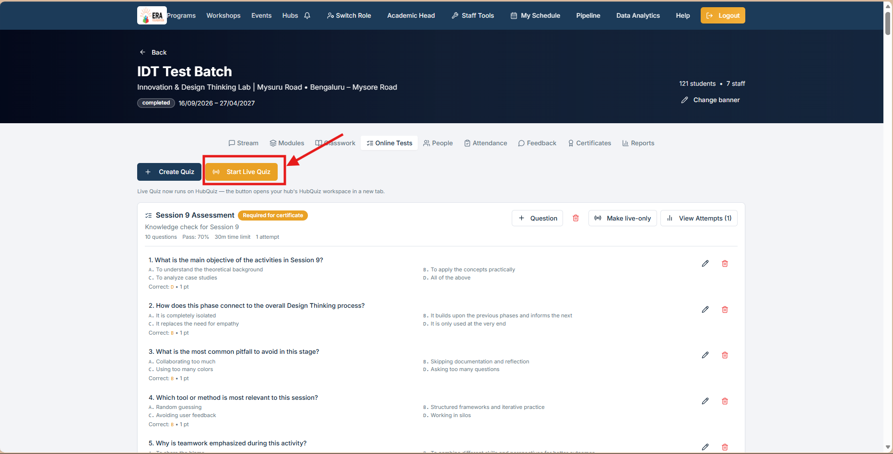
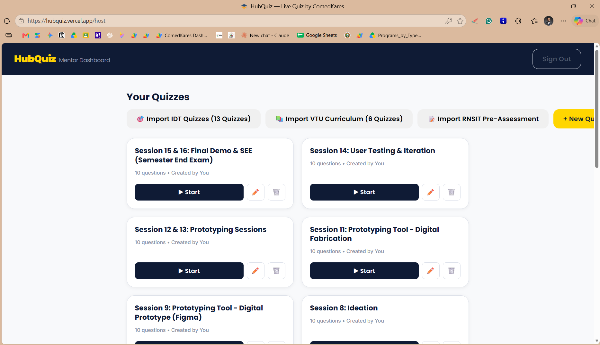
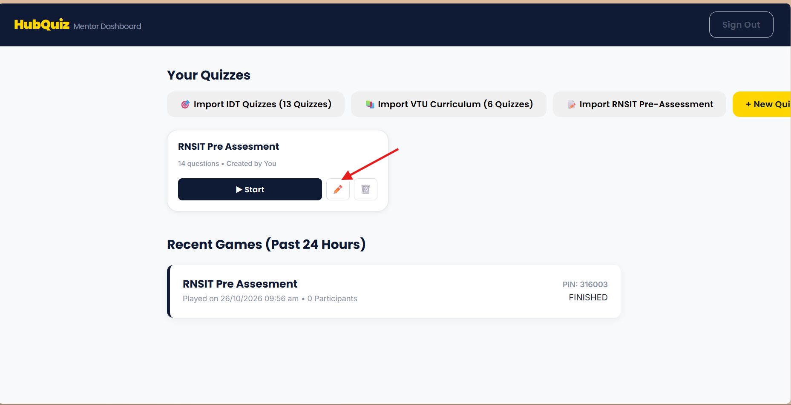
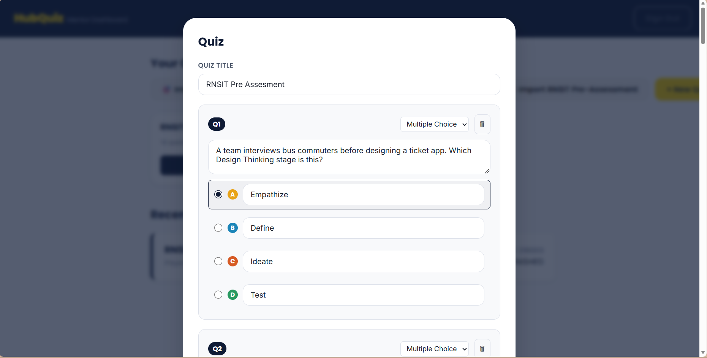
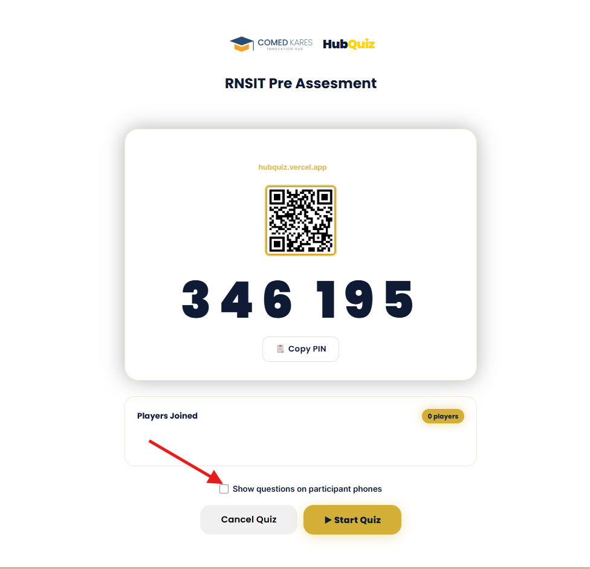
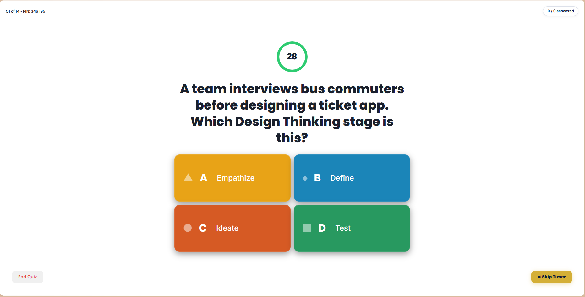

# Team Update Instructions

## Workflow Updates

### HubQuiz Hub Account Sign-In & Resilience Updates
- **Canonical Hub Login Directory**:
  - *Yelahanka Hub*: `blryelahanka.hub@comedkares.org`
  - *Tumkur Hub*: `internship@erafoundationindia.org`
  - *JP Nagar Hub*: `blrjpnagar.hub@comedkares.org`
  - *Mysore Road Hub*: `blrgopalan.hub@comedkares.org`
  - *Mysuru Hub*: `mysuru.hub@comedkares.org`
  - *Mangaluru Hub*: `mangaluru.hub@comedkares.org`
  - *Belagavi Hub*: `belagavi.hub@comedkares.org`
  - *Kalaburagi Hub*: `kalaburagi.hub@comedkares.org`
  - *Hubballi Hub*: `hubballi.hub@comedkares.org`
  - *Central Admin*: `admin@comedkares.org`
- **Automatic Email Alias Normalization**: Mentors who enter regional variations (such as `tumkur.hub@comedkares.org`, `yelahanka.hub@comedkares.org`, or `mysoreroad.hub@comedkares.org`) are now automatically mapped to the underlying canonical database accounts without returning invalid credential errors.
- **Immediate Form Responsiveness**: The login interface renders and activates immediately on load, preventing browser freeze loops.
- **Failover Architecture**: By default, HubQuiz connects to Cloud Supabase for 24/7 high availability, with automatic failover to the JP Nagar local server if Cloud is unreachable.
- **Required Screenshot**: Mentors or admins are requested to capture and upload a screenshot of the Host Dashboard (`hubquiz_host_dashboard.png`) once logged in at `https://hubquiz.vercel.app/host`.

### LMS Quality Audit & Email Governance Workflow
- **Mangaluru Hub PM Mapping**: Mangaluru Innovation Hub directives and communications are officially assigned to **Kavya Rao** (`kavya.r@erafoundationindia.org`).
- **Dashboard Visibility by Role**:
  - *Super Admins*: Full statewide view across all 10 hubs and all 64 batches, with permissions to execute bulk session status flips and trigger automated email runs.
  - *Hub Program Managers*: Scoped to their assigned hub, with direct email preview, mailto reply launcher, and hub batch compliance monitoring.
  - *Mentors & Facilitators*: Scoped to delivery SOP and assigned session attendance.
- **Portal Access (`#/admin/audit`)**: Administrators can navigate to the "Quality Audit" link in the top bar to inspect statewide batch health across all 10 hubs.
- **Weekly Schedule**:
  - Primary Audit runs every **Friday at 12:00 PM IST**.
  - Weekly Nudge runs every **Monday at 09:00 AM IST**.
  - SLA Resolution Deadline is **Tuesday at 05:00 PM IST**.
- **Hub PM Email Dispatch**:
  - Every hub directive email is sent to the respective Hub Program Manager (`astle.j`, `chandana.p`, `nivedha.d`, `kalmesh`, `sandeep.s`, `nithil.d`, `siddagouda.patil`, `sandhya.b`, `askabbur`).
  - The central team (`uditb@erafoundationindia.org`) is automatically kept in CC on 100% of transmissions.
  - An executive master briefing is sent directly to `uditb@erafoundationindia.org`.
- **Safe Auto-Fixes Execution**:
  - Concluded past sessions left in "Scheduled" status can be converted to "Completed" with one click directly from the portal, unlocking student milestones in Supabase.
- **Required Screenshots**:
  - Please capture and upload screenshots of the new Quality Audit Dashboard tab, the Hub Email Modal, and the Safe Auto-Fixes panel.

- **Newsletter Generation Strategy:** We have transitioned from standard DOCX python automation to generating highly detailed Markdown (`.md`) reports for rich-text publications. This allows for inline CSS styling, better image alignment, and a more magazine-like layout while remaining entirely text-based and easy to version control.
- **Image Referencing:** Ensure that when rendering the Markdown newsletter (`D:\Mgmt_Reports\ComedKares_Jan_Sept_2026_Newsletter.md`), the absolute local paths pointing to `D:\Mgmt_Reports\extracted_images\...` remain valid on the host machine.
- **Copywriting Standard:** Ensure no em-dashes are used in future copy additions, adhering strictly to commas or hyphens.

### Program Activation & Syllabus Uploads
- **Programs Activated**: Several Yelahanka and Mangaluru programs have been enabled in the LMS.
- **Syllabus Automation**: The program syllabi have been bulk-uploaded from the provided document to the `program_syllabus` tables. Note that some programs (like Applied AI) did not have a syllabus in the master document and will need to be manually updated later.

- **Applied AI Syllabus Generation**: Created and successfully injected a 12-week custom syllabus for "Applied AI & Agentic Systems - Semester 6" which was previously missing from the master document.

- **Robotics & System Intelligence Syllabus Generation**: Created and successfully injected a 12-week custom syllabus for "Robotics & System Intelligence - Semester 3" which was previously missing from the master document.

- **Data Science Internship & Semester 5 Syllabus Sync**: Corrected a mapping issue where the 90-day internship was applied to Semester 5. The 96 internship entries are now loaded correctly in the `DATA SCIENCE & AI/ML Internship`, and a new 12-week syllabus has been generated and populated for `Data Science & AI/ML - Semester 5`.

### Flagship Programs HTML Portal
- **New Deliverable**: Created `ComedKares_Flagship_Programs.html`, a fully styled, responsive HTML file containing the collated flagship programs data. 
- **Usage**: The HTML file uses CSS variables for easy updates to the brand colours if required.

- **Refined Deliverable**: Created `ComedKares_Flagship_Programs_v2.html` featuring a streamlined 5-section structure and enhanced visual styling.

- **Collapsible UI Update**: Eliminated horizontal tables for session content and implemented a sleek, mobile-friendly accordion (collapsible) UI.

## Attached Screenshots

- **Session Content Restriction**: Restricted the inner content of each session accordion to strictly display only the Session Description, Topics Covered, and Outcomes. All extraneous columns have been removed.

- **Semester Mapping & Filtering**: Each program card header now explicitly displays the mapped semester (e.g., "Semester 1"). Additionally, any session rows related to "CIE deliverables" have been filtered out to ensure only actual training sessions are visible.

- **Main Program UI Update**: Modified the main program cards to behave as collapsible accordions. When clicked, the program's details and session lists expand or collapse natively without needing JavaScript.

- **Session Enumeration**: Replaced the "Week" label in the session breakdown with an automatic sequential "Session 1", "Session 2", etc.

- **Administrative Filtering**: Added logic to successfully filter out administrative sessions like "Program Enrolment Form" and "Pre-Assessment" from the generated HTML view.

- **CIE Filter Fix**: Implemented a Regex word-boundary filter to accurately target and remove all sessions titled "CIE:" or containing the exact word "CIE" without falsely matching standard words like "science". 

- **Internship Title & Description Updates**: Integrated custom descriptions for the Data Science and Robotics internships. Updated their session listings to display "Day X" instead of "Session X", while dynamically stripping out redundant "Day X" text from the titles themselves.

- **IDT Session Content Replacement**: The session coverage for Innovation and Design Thinking (IDT) has been completely rewired. It now actively parses and uses the validated reference data directly from `IDT_Session_Coverage_and_Learning_Activities.docx`, bringing in accurate Descriptions, Topics Covered, and Learning Outcomes for each session.

- **IoT Curriculum Expansion**: Wrote and integrated a detailed 12-session curriculum module for the "Internet of Things (IoT)" program, expanding the provided session topics into full descriptions, learning outcomes, and topic breakdowns. Also populated its missing program description and skills list.

- **AI/ML Internship Detail Fixes**: Added the specific missing "Skills Acquired" list for the Data Science and AI/ML Internship. Additionally, stripped hardcoded prefix numbers from session titles and dynamically mapped the provided week-by-week topic syllabus to fill in the missing "Topics Covered" fields for all its sessions.

- **Session Formatting Styling Update**: Redesigned the individual session breakdown sections across all programs. Replaced the generic tags with a unified `.session-section` style container that features the requested solid blue left border, 1rem padding, and bold, uppercase `#5b7b97` colored subheadings that perfectly matches the reference design.

- **Session Title Punctuation Cleanup**: Strengthened the regex filtering logic for session titles. It now successfully targets and strips any lingering colons (`:`) or hyphens that might have been left orphaned at the beginning of a title after stripping the "Day X" or numerical prefixes.

- **Branding Upgrade**: Replaced the subtitle underneath the main page heading with the official ComedKares logo image (`Comedkares-Logo-EPS.png`), giving it a clean white padded background to ensure proper contrast against the dark blue `<header>`.

- **Internship Boilerplate Pruning**: Cleared out the heavily repetitive and placeholder "Session Description" text found within the Data Science & AI/ML track syllabus data. This eliminates visual clutter so that the focus directly hits the meticulously mapped `Topics Covered` and `Outcomes`.

- **Dynamic Content Generation for AI/ML Internship**: Wrote a dynamic contextual content engine (`dsai_content_generator.py`) to systematically analyze the 90+ individual session titles of the Data Science & AI/ML Internship and automatically populate highly specific `Session Descriptions` and `Topics Covered` where the syllabus data was missing or too vague.

- **Applied AI & Agentic Systems Rewrite**: Completely overhauled the program description and outcomes for the Semester 6 Applied AI course to match the newly provided copy. Tools like LangChain and Vector Databases were added strictly to the 'Skills Acquired' pill list rather than hardcoded into the session timelines to ensure marketing safety as requested.

- **Curriculum Normalization and Em-Dash Rule Enforcement**: I completely rewrote the 12-week internal session content for the `Applied AI & Agentic Systems` track, moving it away from the old, hardcoded hackathon data (which had nothing to do with the prompt engineering/RAG syllabus). I wrote a brand new module sequence (`applied_ai_data.py`) with highly detailed, syllabus-appropriate descriptions and clean, comma-separated keywords for 'Topics Covered'.
- Additionally, I implemented a global cleanup rule in the generator script to recursively find and replace any stray em-dashes (`--`) found in the RSI and other programs, converting them to standard hyphens to ensure strict compliance with project copywriting rules.

- **RSI Internship Content Generation**: Analysed the `Robotics & System Intelligence Internship` program and discovered it was suffering from the same repetitive boilerplate descriptions as the DSAI Internship used to have. I wrote a dedicated dynamic Python content generator (`rsi_content_generator.py`) and wired it into the HTML generation pipeline. This automatically scans all 90 days of the RSI Internship, detects keywords (like 'Python', 'Arduino', 'YOLO', 'ROS'), and assigns contextually accurate, highly professional `SESSION DESCRIPTION`s and comma-separated `TOPICS COVERED`, ensuring all programs match the high-quality layout style requested.

- **3-Column Grid Layout Implementation**: Converted the main `.container` from a single-column stacked layout to a responsive 3-column CSS Grid. The max-width was expanded to `1600px` to comfortably accommodate the three columns on large displays, with progressive media queries ensuring it falls back to 2-column or 1-column grids on smaller devices (tablets and mobiles). The cards now use `align-items: start;` so they expand independently without artificially stretching neighbouring cards vertically.
- **Program Removal**: Removed the `PrepIndia Career Readiness` track from the `PROGRAMS` array in the generator configuration, ensuring it is completely excised from the final rendered brochure.

- **Multi-Page Architecture Re-factor**: Overhauled the HTML generation pipeline. The system no longer produces a single monolithic, slow-loading accordion page. Instead, it generates a clean `index.html` featuring a perfectly aligned 3-column grid of program cards. When clicked, these cards navigate the user to dedicated standalone HTML pages for each specific program (e.g., `program_innovation___design_thinking.html`). The cards use `display: flex; align-items: center;` to ensure perfectly centered alignment of titles and badges regardless of text wrapping.

- **Modern 4-Column Card Grid Implementation**: Completely redesigned the `index.html` dashboard grid based on the provided modern white-card reference. The layout has been migrated to a sleek 4-column responsive CSS Grid. The cards now feature a white background with a subtle hover drop-shadow, rounded borders (16px), and a clean vertical flow:
  - Top: Injected SVG iconography corresponding to the program type (stack of layers for standard semesters, a brain for AI/ML, and a robot for RSI).
  - Subheader: Automatically formatted semester identifiers (e.g., "1st Semester", "Internship") in the brand's accent orange color.
  - Body: A dark blue program title, followed by a truncated excerpt of the program description (first 150 characters) designed to equalize card heights naturally.
  - Footer: A bold "LEARN MORE" call-to-action anchored to the bottom.

- **Details Page UI Synchronization**: Ensured every individual program's dedicated page precisely matches the requested detailed UI structure:
  - Fixed a Python string-interpolation bug (`f-string` escaping issue) that temporarily rendered variable names instead of dynamic data in the accordions.
  - Replaced native OS emojis with scalable, monochrome orange SVG icons (Target, Book, Calendar, Tools, Document) for section titles, giving them a perfectly consistent, professional rendering across all devices.
  - Adjusted the grid-boxes for `Program Outcomes` and `Program Overview` to feature the subtle `#f8fafc` background with perfectly scaled orange circle bullet points.
  - Cleaned up the accordion design to maintain a crisp white background with minimalistic typography.

- **Data Science & AI/ML Curriculum Override**: Overrode the default Excel sheet mapping for the "Data Science & AI/ML" (Semester 5) program. Created a dedicated `ds_aiml_data.py` data structure to store the new, highly specific 12-session curriculum provided by the user.
  - The new curriculum covers everything from Python fundamentals and EDA, to math foundations, SQL, and End-to-End ML Pipelines over exactly 12 structured sessions.
  - Modified `generate_multi_page.py` to bypass the `MLOps` spreadsheet for this program and instead dynamically render the custom Python data.

- **Internship Session Title Regex Fix**: Updated the title cleaning logic (`clean_titles.py`) to systematically remove repetitive "Day X:", "Session X:", and "Week X:" prefixes from the raw dataset. The UI now relies entirely on the programmatic counter (`label = "Day" if "INTERNSHIP" in sheet_name else "Session"`) for the orange pill-tag, ensuring the dark blue session title remains perfectly clean (e.g. `Day 1 | 6 hrs` → `Program Onboarding & Electronics Basics`).

- **ComedKares Knowledge Portal Creation**: Created a new single-page React-like web application (`index.html`) using vanilla HTML, inline CSS, and JavaScript. The portal integrates directly with Supabase for data and Google Auth.
- **Login Restriction**: Implemented a secure Google OAuth flow restricted exclusively to `@erafoundationindia.org` and `@comedkares.org` email accounts.
- **Inline Editor**: Added dynamic "Edit session" and "Add session" admin panels. Admins can seamlessly update sessions on the fly without leaving the portal or requiring redeployments.
- **Unified Media Embeds**: Wired the system to perfectly embed Google Docs, Slides, and external videos inside a unified viewing pane for each session.

## Update - October 8, 2026
* **Session Details**: You will now see a "Revised" date in the top right of the session page indicating when the content was last updated.
* **Layout Adjustments**: The presentation grid has been tweaked. Slides will now appear noticeably larger than the Facilitator Script for easier presenting. The Activity Book preview has also been condensed so it doesn't take up as much screen space.

* **Layout Priorities**: You will notice "Files & Presentation" is now displayed higher on the page than "Resources", allowing mentors to quickly jump into their script.
* **Resources Layout**: Resources are grouped into a neat 2-column list containing Videos, Activity Books, and Reference Articles.

* **Scroll Protection**: When scrolling down the page, embedded documents will no longer "trap" your mouse wheel. You must first click the "Click to interact" overlay to scroll inside the document itself.
* **Loading State**: Files now show a sleek pulsing background while they load, rather than just empty white space.
* **Support Contact**: If a file fails to load or asks for permission, a helpful support message and contact email are now displayed directly underneath the file.

* **Slide Controls**: The native Google Slides controls (previous/next arrows, slide counter) are now visible and fully functional at the bottom of the presentation viewer! No more black bars.
* **Streamlined Spacing**: The entire page spacing has been standardized. The Slides and Script cards are perfectly aligned in height and width ratios, with clean borders and no inner grey gaps. 

* **Improved Slides View**: The maximum width of the layout has been expanded, giving the Slides viewer a much larger preview footprint on big screens.
* **Locked-Down Links**: The "Google Slides" logo on the presentation control bar has been visually blocked to prevent users from accidentally navigating away to the raw file URL.

* **Bigger Slides Layout**: The layout order has been swapped! The Slides player is now positioned on the left side of the grid, taking up the vast majority (75%) of the screen real-estate for a much better viewing experience.
* **Theater Mode Upgrade**: The native popout button in the Google Slides player has been heavily restricted. "Theater Mode" now fullscreens the entire secure wrapper rather than just the raw presentation, keeping our custom protections in place even when viewing full screen!

- **New AI/ML Mechanical Workshop**: A new 5-day workshop titled "5 Day AI/ML for Mechanical Students Skill Lab Workshop" has been created for the Belagavi Hub.
  - A new institute profile was created for "KLS Gogte Institute of Technology (GIT)".
  - The batch is scheduled from 12 October 2026 to 16 October 2026.
  - The 5-day syllabus has been fully parsed and loaded, so mentors can immediately begin using the classwork and session views for this batch.

- **AI/ML Workshop Classwork Availability**: 
  - All 5 daily sessions have been scheduled inside the LMS Classwork tab.
  - The Day 5 Capstone Project is active under the Design Challenges tab. Mentors can guide teams using the recommended public datasets (NASA C-MAPSS, Kaggle Casting Images, etc.).
  - A 10-question Final Assessment Quiz is fully live and will automatically gate the final certificate generation upon passing (70%).
  - Daily Feedback Forms are now accessible natively inside the LMS Feedback tab. No external Google Forms are needed!

- **Modules & Resources Live**: The "Modules" tab in the LMS has now been fully populated. It contains 5 distinct daily modules that include the lesson topics and direct references/links to the exact real-world datasets (Kaggle CNC Mill Tool Wear, NASA C-MAPSS, etc.) mentors should use for each session.

- **Innovation and Design Thinking (IDT) Feedback Forms Now Live Across All Batches**:
  - Mentors across all hubs no longer need to manually construct feedback forms inside their individual batch views.
  - All 16 session feedback forms (Sessions 1 to 16) have been automatically synchronized and mapped across all 34 IDT batches statewide (covering JP Nagar, Tumkur, Mysuru, Hubballi, Kalaburagi, Yelahanka, and Mysuru Road).
  - When opening any IDT batch, navigate to the **Feedback** tab to view the full set of 16 feedback forms ready for responses.

- **Batch Feedback Questions Display Fix**:
  - Resolved an issue where questions inside the "Edit Questions" modal appeared empty when editing batch feedback forms.
  - All feedback questions across all batches now populate properly inside the editor and student forms.

## Update - October 14, 2026: Program Access Control & Request Management
- **Program Permissions & Locked Views**:
  - Curriculum materials, facilitator scripts, presentation decks, and student handouts are now protected based on assigned mentor permissions.
  - If you open a program you are not currently assigned to, you will see a clear **"Access Required"** screen showing the program overview and a **[Request Access to Program]** button.
- **Requesting Program Access**:
  - Simply click **[Request Access]** on the program card or locked session view. You can optionally include a note with your assigned hub or batch.
  - Once submitted, your screen will immediately update to show **"⏳ Access Request Pending Administrator Approval"**.
- **Admin Workflow for Program Grants (`#/admin/access`)**:
  - Administrators will see a **User Access** tab in the top navigation bar with a live count badge indicating pending requests.
  - **Approving Requests**: Click the green **Approve** button to immediately grant access, or **Reject** to decline.
  - **Direct Grant (No Request Needed)**: Admins can proactively grant access to any team member by selecting their name from the team roster and choosing the specific program or **[All Programs]**.
  - **Revoking Access**:
    - *Single Grant*: Click Revoke next to any entry in the Active Grants tab.
    - *All Programs for a User*: Click Revoke All next to any mentor in the Team Members tab to remove their access across all programs.
    - *Program Statewide Revocation*: Filter to a specific program in the Active Grants tab and click Revoke from All to remove access from all non-admin users at once.
- **Program Creation and Default Access**:
  - When adding a new program, administrators can set Initial Mentor Access:
    1. Keep Locked (Mentors request access as needed): Default setting, ideal while drafting new curriculum.
    2. Grant Access to All Team Members Immediately: Automatically provisions access for all team members upon creation.
  - Platform administrators always maintain full unrestricted access to all programs.

## Update - October 21, 2026: RNSIT Pre-Assessment Quiz Available for All Hubs

### What is New
- **RNSIT Pre-Assessment Quiz Now Live**:
  - The refined 14-question Design Thinking Pre-Assessment quiz titled **"RNSIT Pre Assesment"** has been updated across every mentor and hub account. Questions 5, 6, 12, 16, 17, and 18 were removed to keep the quiz focused, and the MVP question was updated to directly test 'What is a Minimum Viable Product (MVP)?'.
  - Topics covered: Design Thinking stages (Empathize, Define, Ideate, Prototype, Test), Empathy Mapping, Problem Framing ("How Might We"), Stakeholder Analysis, Observations vs Assumptions, 5-Why analysis, Brainstorming & Crazy 8s, Low-Fidelity Prototyping, Testing Mindsets, and Minimum Viable Product (MVP).
- **How to Host the Quiz**:
  1. Log in to HubQuiz (`hubquiz.vercel.app` or via your LMS Hub shortcut).
  2. Locate **"RNSIT Pre Assesment" (14 Questions)** on your dashboard.
  3. Click **Start** to open the waiting lobby, project the PIN/QR code for students, and begin the session.
- **One-Click Re-Import**:
  - If you ever delete or modify your quiz and want a clean fresh copy, simply click the **"Import RNSIT Pre-Assessment"** button at the top of your dashboard.

- **RPDT Program Content Live (RNSIT | Mysore Road)**:
  - The complete 7-week syllabus is now available for "Rapid Prototyping & Design Thinking | RNSIT | Mysore Road".
  - Mentors can access the weekly quizzes (Weeks 1 to 7 plus the Final Assessment Quiz) and all 8 session feedback forms directly within the LMS portal without manual configuration.
  - All feedback forms have been pre-synchronized to the active batch (`RNSIT | RPDT | AIML-D | ME 306`) so students and mentors can start collecting responses immediately.

- **Batch Classwork Sessions Live (RNSIT | RPDT | AIML-D | ME 306)**:
  - Mentors can now view the entire 7-session delivery schedule directly under the **Classwork > Sessions** tab for the RNSIT batch.
  - All sessions are scheduled for Thursday afternoons (03:00 PM to 06:00 PM) running through December 2026.
  - The final capstone project is active under the **Design Challenges** tab, configured for team submissions with a 100-point rubric.

## Update - October 22, 2026: Robotics Workshop Content Live (Kalaburagi Hub)

### What is New
- **1-Day Robotics Workshop Content Available**:
  - Content for the 6-hour "Robotics Workshop" in the Kalaburagi hub is now live inside the LMS portal.
  - Students will assemble and control their own 2WD RC mobile bot using dual BO motors, an L298N motor driver, an HC-05 Bluetooth module, and an Arduino Uno.
- **Syllabus Sessions Live**:
  - Mentors can view the complete 7-session breakdown in the program syllabus accordion:
    1. Session 1: Introduction to Robotics & Hardware Components Overview (0.5h)
    2. Session 2: Understanding Robot Components & Working Principles (0.5h)
    3. Session 3: Chassis Mechanical Assembly & Drive Wheel Mounting (1.0h)
    4. Session 4: Power System & Circuit Wiring (1.0h)
    5. Session 5: Arduino IDE Setup & Microcontroller Fundamentals (1.0h)
    6. Session 6: Firmware Programming & HC-05 Bluetooth RC Control Logic (1.0h)
    7. Session 7: Testing, Calibration, Troubleshooting & RC Bot Arena Challenge (1.0h)
- **7 Curriculum Quizzes Configured**:
  - 7 interactive quizzes (10 questions each, totaling 70 questions) are active under the Curriculum section.
  - Covers hardware unboxing, mechanical balance, wiring safety, common grounding, level shifting, serial character decoding ('F', 'B', 'L', 'R', 'S'), and motor brownout troubleshooting.
- **Native Feedback Forms Ready**:
  - All 7 session feedback forms and the End of Workshop Feedback form are active.
  - Forms are synchronized across both the master program curriculum and batch views, eliminating the need to set up external Google Forms.

## Update - October 22, 2026: RPDT (Rapid Prototyping & Design Thinking) Portal Content Live

### What is New for Mentors & Facilitators
- **Complete 8-Week RPDT Curriculum Now Live**:
  - The flagship "Rapid Prototyping and Design Thinking" program (`RPDT`) has been fully compiled and added to the Knowledge Portal catalog (`#/p/RPDT`).
  - Aligned with RNSIT and designed for an 8-week (40-hour) engagement, alternating between 2 hours of active lab facilitation and 1 hour of student portal deliverables (Sessions 1 and 7 feature full 3-hour facilitation).
- **Embedded Slides & Delivery Mode for Every Session**:
  - Each of the 7 sessions includes a verified Google Slides presentation embedded directly into the portal view, complete with presentation controls and Theater Mode.
  - Phased Facilitator Scripts are organized across 5 standardized phases:
    1. *Phase 1 - Hook & Provocation*: Engaging kick-offs, user stories, and provocations.
    2. *Phase 2 - Direct Instruction & Concept Modeling*: Teacher talk-tracks and live demonstrations.
    3. *Phase 3 - Guided Lab Challenge*: Time-boxed, hands-on student builds with mentor checkpoints.
    4. *Phase 4 - Debrief & Assessment*: Formative reflection questions, peer critique, and deliverable logging.
    5. *Phase 5 - Closure & Preview*: Key takeaways and teaser for the upcoming session.
- **Hands-On Lab Activities & Deliverables**:
  - **Session 1**: Catapult Design Challenge (distance battle, build-test-iterate logging).
  - **Session 2**: UI/UX Figma Challenge (clickable high-fi prototypes, 5 Why Titanic case analysis).
  - **Session 3**: Onshape CAD Lab (2D dimensioned sketches for laser cutting, 3D Part Studio modeling, Cura slicing).
  - **Session 4**: Adventuretronics Electronics (LED torch, RGB code lock, LDR automatic street light, circuit soldering).
  - **Session 5**: IoT NodeMCU Lab (ESP8266 Wi-Fi configuration, ThingSpeak live sensor charts, threshold alert rules).
  - **Session 6**: Campus Waste Design Thinking Lab (customer journey mapping, 5W1H/POEMS interviews, empathy & stakeholder mapping, solution-free HMW statements).
  - **Session 7**: Feasibility & Concept Selection Lab (technical/economic/social screening, weighted decision matrices, Rs 3,000-5,000 BOM budget scoping, pitch rehearsal).
- **Research Literature & Video Playlists**:
  - Every session features 4-5 curated academic papers, books, and reference guides (Harvard Business Review, Stanford d.school, Nielsen Norman Group, Maker Media).
  - 4 curated YouTube video links per session are indexed for quick classroom projection or student post-session review.

## Update - October 22, 2026: External User Whitelisting & Admin Visitor Tracker

### What is New for Administrators & Mentors
- **Adding External Users Outside the Organization**:
  - Administrators can now grant access to external collaborators, guest speakers, partner college faculty (e.g. RNSIT, GIT), and external evaluators who use personal Gmail or institutional email addresses.
  - To whitelist an external collaborator:
    1. Navigate to **User Access** in the top navigation bar (`#/admin/access`).
    2. Switch to the **Team Members** tab.
    3. Click the **[+ Whitelist External Member]** button at the top right of the table.
    4. Fill in their Full Name, Google Account Email, Role/Institution, and select their initial program access (e.g. `RPDT`, `★ All Programs`, or leave locked).
    5. Click **Whitelist & Grant Access**.
  - The collaborator can now open the [Knowledge Portal](https://comedkares-knowledge-portal.vercel.app), click **Sign in with Google**, and immediately access their assigned programs.
- **Auto-Whitelisting via Direct Grant**:
  - Administrators using the **Direct Grant Access** tab can also type any external email directly under *-- Other / Enter Email Address --*. Granting access will automatically whitelist the user into the team roster as an "External Member".
- **Confidential Visitor & Content Activity Tracker (Admin Only)**:
  - Administrators now have access to a dedicated **Visitor Tracker** link in the top navigation bar (`#/admin/tracker`).
  - This dashboard is protected by database security policies and is visible only to authorized administrators.
  - **Key Features**:
    - **Visitor Leaderboard**: Identify top active mentors, see which programs each user has explored, and view their last active timestamp.
    - **Content Popularity**: Track which sessions are being viewed the most and how often mentors launch Delivery Mode.
    - **Live Audit Feed**: Monitor recent page visits in real-time.
    - **CSV Export**: Click **[Export Activity CSV]** to download a detailed log for reporting and attendance verification.

## Update - October 22, 2026: Vercel Web Analytics Enabled on HubQuiz

### What is New
- **Live Visitor & Participation Tracking**:
  - Vercel Web Analytics has been integrated directly into the HubQuiz platform (`hubquiz.vercel.app`).
  - The system now records page views, unique visitors, devices, geographical distribution, and participation activity in real time.
- **Viewing Analytics**:
  - Project administrators can log into the [Vercel Dashboard](https://vercel.com), open the **HubQuiz** project, and click the **Analytics** tab to view real-time traffic graphs and student engagement metrics.

## Update - October 22, 2026: Vercel Platform Analytics Live

### Infrastructure Telemetry
- **Vercel Web Analytics Active**: In addition to the internal in-app Visitor Tracker, platform-level analytics from Vercel are now enabled across the portal.
- **Real-Time Traffic Dashboard**: Leadership can monitor global visitor traffic, device breakdowns, and pageview volumes directly from the Vercel project dashboard.

## Update - October 23, 2026: Kalaburagi Robotics Batch Classwork & Feedback Live

### What is New for Mentors in Kalaburagi
- **Kalaburagi Robotics Batch Ready (`Robotics Workshop - Kalaburagi - Oct 2026`)**:
  - All content is live inside the batch portal for Saturday, October 24, 2026.
  - Mentors can navigate directly to the batch to review the delivery schedule, run student feedback checkpoints, and evaluate the final arena challenge.
- **Classwork Schedule (7 Sessions)**:
  - The complete 1-day agenda (09:30 AM to 04:30 PM) is populated under the **Classwork > Sessions** tab.
  - Each session is linked to its matching module (unboxing, component theory, chassis assembly, power wiring, Arduino IDE, Bluetooth firmware, and arena testing).
- **RC Bot Arena Design Challenge Active**:
  - The final hands-on challenge ("RC Bot Bluetooth Arena Challenge & Obstacle Navigation") is live under **Classwork > Design Challenges**.
  - Teams of up to 4 students can submit their bot demo. Mentors can evaluate teams using the built-in 100-point rubric (Chassis Assembly 25 pts, Wiring & Power 25 pts, Bluetooth Firmware 25 pts, Arena Navigation 25 pts).
- **Online Tests / Quizzes Available**:
  - All 7 quizzes (10 questions each) are active under the batch **Online Tests** and **Classwork** views.
- **Single Streamlined Feedback Form Active**:
  - All separate per-session feedback forms have been removed to avoid survey fatigue during the 1-day workshop.
  - A single comprehensive **"Robotics Workshop Feedback"** form is active under the **Feedback** tab.
  - Students will complete this single form at the conclusion of the workshop. Responses are recorded natively within the LMS database, so external Google Forms are not needed.

## Update - October 23, 2026: Login Usability & Admin Access Improvements

### What is New
- **Show/Hide Password Button**:
  - A password visibility toggle button is now available on the login screen. You can tap the eye icon to verify your password before signing in.
- **Direct Admin Dashboard Access**:
  - Administrators are now routed immediately to the Admin Dashboard upon sign-in.
  - One-click admin login is also supported via the SSO shortcut (`?hub=admin`).

## Update - October 23, 2026: One-Click Server Switcher & Login Fix

### What is New
- **Login Loop Resolved**:
  - Fixed an issue where signing in could loop back to the login screen.
  - The login system now recognizes your active session immediately.
- **Manual Server Switcher (JP Nagar vs Cloud)**:
  - You can now see exactly which server you are connecting to right on the login card.
  - If you ever want to force connection to JP Nagar or Cloud, simply click the **(Switch)** link on the login screen or click the server badge in your dashboard header.

## Update - October 23, 2026: Server Switcher Exclusively Reserved for Administrators

### What is New
- **Distraction-Free Login and Dashboard for Mentors**:
  - The server indicator and manual switch buttons are now reserved exclusively for the system administrator (`admin@comedkares.org`).
  - Mentors logging into HubQuiz do not need to choose or switch servers. The system automatically connects you to the primary JP Nagar server, and will automatically switch to Cloud backup if JP Nagar ever goes offline.
- **Administrative Server Switch Controls**:
  - When the administrator enters `admin@comedkares.org` into the login email field, the server switch control becomes active.
  - The administrator can also toggle servers directly inside the Admin Dashboard using the new **Switch Server** button.
- **Stability Improvement**:
  - Fixed an initialization issue where connection checks could temporarily cause an undefined client error on slower networks.

## Update - October 23, 2026: Recently Opened History Cap & Onboarding Guide

### 1. Homepage Recently Opened History Capped at 5
- The **Recently opened** table on the homepage now shows strictly your last 5 accessed sessions, making it easy to resume without cluttering the screen.

### 2. How to Add a New ERA Foundation User
- **Step 1: User Sign-In**:
  - The new mentor can go directly to [https://comedkares-knowledge-portal.vercel.app](https://comedkares-knowledge-portal.vercel.app) and click **Sign in with Google** using their `@erafoundationindia.org` account. They are admitted into the portal automatically.
- **Step 2: Assigning Program Permissions (Admin)**:
  - By default, newly added programs are locked until access is assigned.
  - To grant access ahead of time, go to **User Access** (`#/admin/access`) > **Team Members Roster** tab.
  - Click **[+ Add Member / Collaborator]**, enter their name and email, and pick their assigned program or select **All Programs**.
  - Alternatively, the mentor can click **Request Access** on any program card, and you can approve it with one click under **Pending Requests**.
- **Step 3: Giving Admin Rights (Optional)**:
  - If the user is an administrator or coordinator, add their email to the `admins` table in Supabase.

## Update - October 23, 2026: Team Members Roster Live Search & Instant Entry Confirmation

### 1. New Roster Live Search
- You can now search across all 40+ staff and collaborators directly on the **Team Members Roster** tab (`#/admin/access`).
- Type any partial name, email address, or role into the new search box to instantly filter the table in real time.

### 2. Instant Confirmation for Added Members
- When you add a new team member or external collaborator using **[+ Add Member / Collaborator]**, the system now:
  - Immediately places them at the top of the roster list.
  - Automatically keeps you on the **Team Members Roster** tab.
  - Highlights their entry with a green accent border and a **Just Added / Updated** tag.
  - Smoothly scrolls directly to their row for instant verification.

### 3. Automatic Google Sign-In Registration
- Any staff member signing in with their official `@erafoundationindia.org` or `@comedkares.org` Google account is now automatically registered in the team directory upon their first login.

## Update - October 24, 2026: Statewide Batch Quality Audit & Attendance Remediation Guidelines

### What is New for Mentors & Administrators
- **Statewide Batch Audit Complete**:
  - An end-to-end quality audit across all 10 hubs and 64 batches has been completed.
  - A comprehensive report workbook is now available: `ComedKares_Statewide_LMS_Audit_Report.xlsx`.
- **Immediate Action Items for Hub Mentors**:
  - **Attendance Verification**: Mentors assigned to active IDT batches in JP Nagar (T John college), Kalaburagi, and Yelahanka must review past session dates and ensure attendance rosters are fully synced and marked.
  - **RPDT Mysore Road Classwork Ingestion**: Facilitators handling RNSIT batches must ensure classwork sessions are populated from the master 7-session RPDT dossier prior to lab delivery.
  - **Date Corrections**: Corrected batch start dates with typographical errors (e.g. year 2926 and year 0026) to maintain accurate calendar displays on the student dashboard.
- **Audit Workbook Breakdown**:
  - Mentors and leads can open `ComedKares_Statewide_LMS_Audit_Report.xlsx` in Excel to filter by their specific hub and view batch student counts, session schedules, and attendance marking completion rates.

## Update - October 24, 2026: Facilitator Script Dual Recognition

### What is New
- **Full Recognition for Manual Script Text**:
  - The Knowledge Portal now recognizes facilitator scripts whether they are attached as an external Google Doc link or typed directly into the portal as formatted text.
  - Previously, programs whose scripts were typed in manually showed `0 of 12` or `0 of 14` under the **Script linked** column. This has been resolved, and programs like IDT, IIP, and RSI now correctly display their full script counts (e.g. `12 of 12`).
- **Informative Hover Breakdown**:
  - Hovering over any script count on the homepage now shows an informative breakdown indicating how many sessions use linked Google Docs versus formatted text scripts.
- **Sidebar & Search Badges Updated**:
  - The **D** badge in the left sidebar and search results now lights up appropriately for both Google Docs and typed script text.

---

## Team Announcement: Statewide IDT Batch & Classwork Audit Results (Pre-Oct 24)
**Date**: October 24, 2026  
**Target Audience**: Hub Coordinators, Program Managers, and IDT Mentors

### Key Operational Takeaways
1. **Classwork Dates Verified**: All 490 sessions across all 37 Innovation & Design Thinking Lab batches are mapped to concrete dates.
2. **Pre-Oct 24 Attendance Escalation**: Across 265 delivered past sessions, only 107 (40.4%) have attendance marked in the LMS, leaving 158 past sessions without attendance.
3. **Hub Level Action Required**:
   - **JP Nagar Hub**: Mentors for T John Institute Sections A, E, and F must log backdated attendance for Sessions 1 through 8 immediately.
   - **Tumkur Hub**: Mentors for SIET Batches 1 to 9 must complete attendance logging for Sessions 4 (Oct 12) and 5 (Oct 19).
   - **Mysuru Hub**: Mentors for MITM and MITT must finalize attendance for Sessions 5 to 7.
   - **Kalaburagi Hub**: Mentor must log attendance for Sessions 5, 6, and 7 delivered during Oct 19 to 21.

### Program Manager Operational Directives (Master Feedback & Attendance Reconciliation)
1. **Attendance vs Feedback Cross-Check (JP Nagar)**: PM Astle John must coordinate with T. John Institute mentors to convert the 90 weekly student feedback submissions into official LMS session attendance logs for Sections A, E, and F.
2. **Weekly Survey Form Deployment (Tumkur & Hubballi)**:
   - PM Nithil Dass to deploy Session 4 and 5 feedback forms across SIET Tumkur.
   - PM Kalmesh to roll out Sessions 3, 4, and 5 feedback forms at PDIT Hospet.
3. **MIT Kesare Survey Launch (Mysuru)**: PM Chandana P to activate weekly session feedback collection for MIT Kesare students.
4. **Master Document Access**: The unified executive report is available at `d:\Anti_spamm\ComedKares_IDT_Statewide_Audit_and_Feedback_Report.docx`.

---

## Team Announcement: ComedKares HubQuiz Platform Live in LMS
**Date**: October 26, 2026  
**Target Audience**: All ComedKares Mentors, Hub In-Charges, Lead Facilitators, and Academic Coordinators

### What is HubQuiz?
HubQuiz is ComedKares' official, in-house live quiz platform designed to replace external paid tools like Kahoot and Mentimeter across all our innovation hubs. It is engineered specifically for our workshop environment to deliver fast, engaging, and dependable classroom assessments.

### Key Highlights for Mentors
- **Zero Student Setup**: Students never need to download apps or create accounts. They simply scan a QR code with their mobile cameras or enter a 6-digit PIN on any phone browser.
- **Direct LMS Access (Single Sign-On)**: Click the orange **((•)) Start Live Quiz** button under the **Online Tests** tab of your batch. You are automatically signed into your hub account.
- **Pre-loaded Curriculum**: 13 IDT quizzes, 6 VTU curriculum quizzes, and RNSIT pre-assessments are ready to launch in 1 click.
- **Phone Display Toggle**: In large halls where the projector is hard to read from back rows, enable "Show questions on participant phones" so students see the questions directly on their devices.
- **Dual-Tier Reliability**: Operates seamlessly on local hub servers with automatic Cloud failover if classroom connectivity drops.

### Visual Workflow Guide

#### 1. Finding the Button in Your LMS Batch
Open your batch in the ComedKares LMS, select the **Online Tests** tab, and click the orange **((•)) Start Live Quiz** button.

#### 2. Your HubQuiz Mentor Dashboard
Access all pre-loaded assessments, import standard curriculum packages, or create new quizzes with the `+ New Quiz` button.

#### 3. Customizing Questions
Click the pencil icon on any quiz card to edit question descriptions, options, or correct answers.

#### 4. Launching the Quiz in Class
Click `▶ Start` on your quiz. Connect your laptop to the classroom projector. Students scan the QR code to join. Be sure to check **Show questions on participant phones** if you want questions displayed on student devices.

#### 5. Hosting the Live Game
Control the flow of the assessment with the 30-second timer, live response counter, and `Skip Timer` button.

### Mentor Operational FAQs
- **Q: Where is the button located?** In the LMS, open your batch and click the **Online Tests** tab.
- **Q: Do students need an app?** No. Any mobile phone with a browser works instantly.
- **Q: Can students see questions on their phones?** Yes, simply check the "Show questions on participant phones" box in the lobby before clicking Start Quiz.
- **Q: What if classroom internet is slow?** HubQuiz uses an ultralight realtime protocol consuming under 50 KB per session, running smoothly even on mobile hotspots.
- **Q: Where is the complete guide?** Download the comprehensive manual from `C:\Users\DELL\Desktop\ComedKares_HubQuiz_Mentor_Guide.docx`.

## Team Update - October 27, 2026: Build 4 Karnataka Mangaluru Edition & Statewide Regional Hubs

### Overview for Team Members
The Build 4 Karnataka web portal has officially launched the **Mangaluru Edition** as its main homepage! The Bengaluru event archive has been shifted to /bengaluru/ and dedicated upcoming city edition pages have been deployed for five additional hubs across Karnataka.

### Key URLs for Outreach & Student Queries
- **Main Portal (Mangaluru Edition)**: https://build4karnataka.comedkares.com/
- **Student Registration Link**: https://forms.gle/M2Q93UHtBamjD3GM8
- **Bengaluru Event Archive & Results**: https://build4karnataka.comedkares.com/bengaluru/
- **Mysuru Coming-Soon Page**: https://build4karnataka.comedkares.com/mysuru/
- **Belagavi Coming-Soon Page**: https://build4karnataka.comedkares.com/belagavi/
- **Hubballi Coming-Soon Page**: https://build4karnataka.comedkares.com/hubballi/
- **Kalaburagi Coming-Soon Page**: https://build4karnataka.comedkares.com/kalaburagi/
- **Tumakuru Coming-Soon Page**: https://build4karnataka.comedkares.com/tumakuru/

### Team Action Items
1. **Promote Mangaluru Registrations**: Direct interested student teams from coastal and statewide engineering colleges to https://build4karnataka.comedkares.com/. Registrations are now active via Google Forms.
2. **Support Regional Queries**: Students inquiring about other cities (Mysuru, Hubballi, Belagavi, Kalaburagi, Tumakuru) can be pointed to their respective city links where they can join the WhatsApp notification list.
3. **Showcase Past Success**: If applicants ask about previous editions, share https://build4karnataka.comedkares.com/bengaluru/ to view winning projects, jury details, and photo highlights.

### Required Screenshots
- [ ] Please capture and upload a screenshot of the Mangaluru Edition Hero section for team reference (screenshot_mangaluru_hero.png).

### Update - Mangaluru Edition Refinements (Capacity, Build Day Flow & Contact Number)
1. **Total Available Capacity**: Exactly 50 slots available on a first-come, first-served basis without screening or shortlisting.
2. **Build Day Schedule (Nov 28)**:
   - 9:00 AM - 2:00 PM: Dedicated build time for product development.
   - 2:00 PM - 4:00 PM: Presentation to the jury panel at tables.
3. **Official Contact Number**: Updated to +91 89519 55096. Please update your outreach copy and student communication channels accordingly.

### Update - Hero Map Responsive Scaling Fix
- **Viewport Optimization**: Scaled down the interactive Karnataka map from 700px to 490px on desktop and 400px on laptops.
- **Full Regional Visibility**: The map no longer clips at the bottom, ensuring the Mysuru edition marker and southern Karnataka border are completely visible on all laptop and mobile screen resolutions.

### Update - Mentor & Jury Placeholder Cleanup
- **Designations Temporarily Cleared**: All placeholder roles on the Jury and Mentor cards have been removed for the Mangaluru edition.
- **Announcement Protocol**: As official jury members and floor mentors are confirmed, their verified names, photos, and professional designations will be updated simultaneously.

### Update - Expanded Eligibility & Team Size Rules
1. **Who is Eligible**:
   - All undergraduate engineering students (any branch).
   - MCA students.
   - Recent passouts / graduates from the past academic year.
2. **Team Size Limit**:
   - Maximum 4 members per team (teams of 2 to 4 members). Teams larger than 4 cannot be accepted.

### Update - Hero Floating Console Repositioned
- **Map Visibility**: Moved the floating status console widget below the Karnataka map so all districts (including Mysuru and Bengaluru) remain 100% clear and interactive without any visual overlap.
